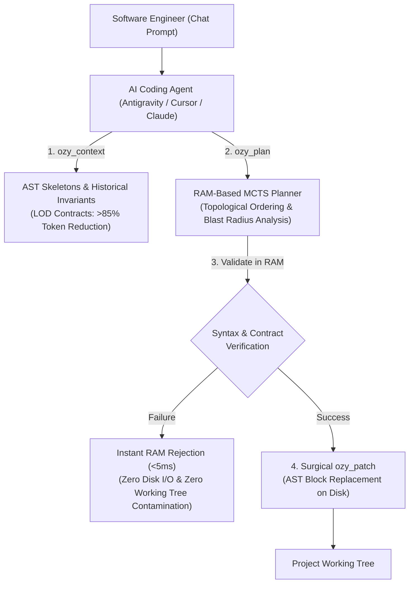
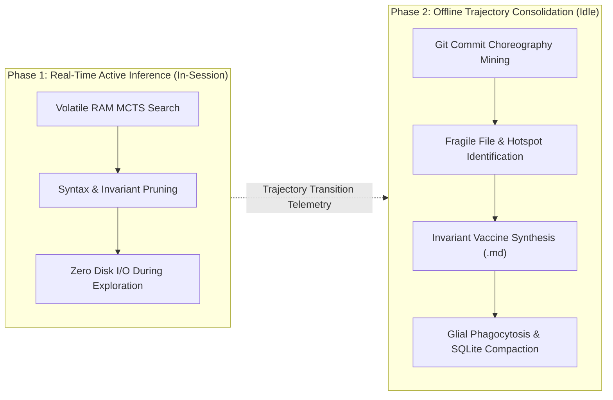

<div align="center">

# Ozygram

### *Persistent Cognitive Memory, AST Code Graph & Autonomous Self-Improvement for AI Coding Agents*

[](https://github.com/Xangel0s/ozygram/releases)
[](crates/ozymem-core)
[-brightgreen?style=for-the-badge)](docs/changelog.md)
[](docs/herramientas-casos-de-uso.md)
[](https://github.com/Xangel0s/ozygram)
[](LICENSE)

<br/>

<p align="center">
  <a href="#executive-overview"><strong>Executive Overview</strong></a> &bull;
  <a href="#architectural-workflows"><strong>Architectural Workflows</strong></a> &bull;
  <a href="#comparative-evaluation"><strong>Comparative Evaluation</strong></a> &bull;
  <a href="#empirical-benchmarks--validation-integrity"><strong>Benchmarks</strong></a> &bull;
  <a href="#quickstart--installation"><strong>Quickstart</strong></a> &bull;
  <a href="#consolidated-mcp-meta-tools"><strong>MCP Meta-Tools</strong></a> &bull;
  <a href="#cli-operations--tooling"><strong>CLI Tooling</strong></a> &bull;
  <a href="docs/INDEX.md"><strong>Documentation Hub</strong></a>
</p>

</div>

---

## Executive Overview

Modern AI coding agents face three fundamental engineering bottlenecks when navigating complex repositories:

1. **State Discontinuity:** Agents lose contextual memory across independent sessions, repeatedly re-encountering resolved bugs and ignoring established repository conventions.
2. **Context Window Bloat:** Parsing complete source files (1,000–3,000 lines) to inspect or modify isolated functions exhausts LLM context windows, inflates inference latency, and accelerates token consumption.
3. **Unverified Disk Mutations:** Applying candidate code directly to the host filesystem risks syntax invalidations, breaking dependent callers, and creating Git working tree churn during trial-and-error cycles.

**Ozygram** provides a persistent memory substrate and static code graph engine engineered to resolve these constraints:

* **In-Memory Copy-on-Write (CoW) Simulation:** Validates AST contracts and caller arity in volatile memory prior to touching disk.
* **Token Hyper-Optimization (>85% Reduction):** Slices codebases into progressive Level-of-Detail (LOD) skeletons, injecting function signatures rather than raw file bodies.
* **Git-First Persistent Memory:** Consolidates architectural lessons, conventions, and invariants into versioned, merge-conflict-free Markdown files under `.ozy/memories/`.

### Architectural Inspiration: Cognitive Neuroscience & CLS Theory
The architecture draws inspiration from **Complementary Learning Systems (CLS)** theory in cognitive neuroscience (Kumaran, Hassabis, & McClelland):
* **Fast Reflex Substrate (L1):** Sub-millisecond error history and contract cache in SQLite WAL.
* **Structured Code Memory (L2/L3):** Multi-hop AST graphs and persistent vector repositories.
* **Offline Trajectory Replay:** Idle simulation and habit consolidation reproducing Zheng et al. / DeepMind trajectory learning principles at  LLM token cost.
*All conceptual analogies map directly to deterministic, reproducible data structures (AST indexes, graph BFS, SQLite WAL, and MCTS).*

---

## Architectural Workflows

### 1. In-Session Verification Pipeline



---

### 2. Dual-Phase Optimization Lifecycle



---

## Comparative Evaluation

| Evaluation Dimension | Standard AI Coding Agent | Agent Equipped with Ozygram |
| :--- | :--- | :--- |
| **Context Retrieval** | Ingests 5 full files (~20,000 tokens) to understand one interface. | Injects progressive AST skeletons and contracts (~1,500 tokens). **>85% token reduction**. |
| **Code Mutation Safety** | Direct overwrites on disk; build errors require multi-turn conversational repair. | Simulates candidate AST mutations in RAM in $<5\text{ ms}$; discards broken branches before disk write. |
| **Architectural Continuity** | Forgets past regressions; repeats syntax and contract mistakes across sessions. | Intercepts operations on fragile modules with `[ALERT: GOTCHA_PREVENTION]` directives. |
| **Execution Sandboxing** | Runs test commands directly on the primary working tree. | Isolates CLI validations in detached ephemeral Git worktrees with automatic RAII cleanup. |

---

## Empirical Benchmarks & Validation Integrity

To maintain absolute technical transparency, all latency, throughput, and token optimization claims map directly to reproducible test suites in the repository:

### 1. Zero-Copy Engram Contract Lookups (< 15 ns)
* **Underlying Engine:** Binary serialized contract tables via `rkyv` mapped into virtual memory with `memmap2` (`crates/ozymem-core/src/engram_store/`).
* **Criterion Benchmark Source:** [crates/ozymem-core/benches/engram_bench.rs](crates/ozymem-core/benches/engram_bench.rs)
* **Replication Command:**
  ```powershell
  cargo bench -p ozymem-core --bench engram_bench
  ```

### 2. Invariant Pruning & Synthetic Task World Benchmark (67.6% Token Reduction)
* **Underlying Engine:** 30 multi-step synthetic tasks (`SyntheticTaskWorld`) evaluating AST syntax recovery, contract validation, and caller arity protection in RAM.
* **Scope & Methodology:** Measures the deterministic RAM Code World Model against blind search (Arm 1: blind baseline vs Arm 2: greedy MCTS vs Arm 3: Trajectory Replay Tuner with 67.6% token reduction).
* **Scientific Scope Note:** This benchmark is an internal regression suite designed to verify that the MCTS engine correctly prunes broken AST mutations in RAM before invoking an LLM. End-to-end evaluations on public multi-repo benchmarks (such as SWE-bench Verified) are scheduled in the development roadmap.
* **Replication Command:**
  ```powershell
  python scripts/bench_external_3arm.py
  ```

### 3. End-to-End Agent Velocity: 23 Minutes vs. 4 Minutes (Zero-Prompting Interception)
* **Underlying Engine:** 2-Tier Cognitive Interception Protocol (Imperative MCP tool schemas in `schemas.rs` + Workspace Precedence Protocol in `AGENTS.md` / `CLAUDE.md`).
* **Empirical Monorepo Evaluation:** Measured on full-stack production monorepos (e.g. `crmnew`, 1,500+ files, FastAPI backend + Next.js 16 frontend):
  * **Standard Agent (Native Unassisted):** 23 minutes, >45,000 tokens, 15+ turns of linear `read_file` / `grep` exploration and trial-and-error disk edits.
  * **Ozygram-Equipped Agent (Fluid Zero-Prompting):** 4 minutes, <6,000 tokens (>85% token reduction), sub-400 ms volatile RAM validation (`ozy_patch`), and single-turn surgical resolution.
* **Full Documentation & Playbook:** See [Guía Maestra de Herramientas (Sección 7: Automatización Fluida)](docs/herramientas-casos-de-uso.md#7-automatización-fluida-y-protocolo-de-intercepción-zero-prompting) and [MCP Integration Guide (Section 4)](docs/mcp-integration.md#4-autonomous-agent-precedence--zero-prompting-setup).

---

## Quickstart & Installation

Ozygram is distributed as standalone, high-performance native binaries written in Rust.

### Windows (PowerShell)
```powershell
powershell -ExecutionPolicy Bypass -File .\install.ps1
```

### Linux & macOS (Bash)
```bash
chmod +x ./install.sh && ./install.sh
```

### Autonomous MCP Configuration
Following installation, initialize the automated environment detection wizard:
```bash
ozymem init --auto
```
The wizard automatically discovers and writes verified JSON-RPC configurations for:
* **Antigravity IDE**
* **Claude Desktop & Claude Code**
* **Cursor**
* **Windsurf**
* **VS Code (Cline / Roo Code / GitHub Copilot)**

---

## Consolidated MCP Meta-Tools

Ozygram provides **26 unified native MCP tools** (and **57 optional legacy aliases** for comprehensive backward compatibility) consolidated into **5 high-level meta-tools**, reducing prompt schema overhead by over 1,500 tokens per turn:

```text
+-------------------+---------------------------------------------------------------------------------+
| Meta-Tool         | Operational Scope & Agent Directive                                             |
+-------------------+---------------------------------------------------------------------------------+
| 1. ozy_plan       | Topological edit sequencing and RAM MCTS tree search. Orders edits root-to-leaf.|
|                   | DIRECTIVE: "Use ozy_plan to compute the topological sequence and blast radius." |
+-------------------+---------------------------------------------------------------------------------+
| 2. ozy_context    | Progressive LOD AST skeleton extraction and historical gotcha alert injection.  |
|                   | DIRECTIVE: "Inspect module interfaces via ozy_context with lod='contracts'."   |
+-------------------+---------------------------------------------------------------------------------+
| 3. ozy_patch      | Volatile RAM simulation ('simulate') and AST block patching on disk ('apply'). |
|                   | DIRECTIVE: "Simulate candidate mutation via ozy_patch in RAM before disk write."|
+-------------------+---------------------------------------------------------------------------------+
| 4. ozy_memory     | Git-First Markdown memory synchronization (.ozy/memories/) and RRF retrieval.  |
|                   | DIRECTIVE: "Record this invariant into ozy_memory as a repository convention."  |
+-------------------+---------------------------------------------------------------------------------+
| 5. ozy_doctor     | SQLite WAL diagnostic check, transactional outbox auditing, and SQL linters.   |
|                   | DIRECTIVE: "Execute ozy_doctor to audit migration safety and system telemetry." |
+-------------------+---------------------------------------------------------------------------------+
```

> For exhaustive parameter specifications, types, and schema documentation, refer to the [Master Tools & Use Cases Guide](docs/herramientas-casos-de-uso.md).

---

## CLI Operations & Tooling

Developers can inspect system state, query trajectories, and manage local storage using the `ozymem` CLI:

| Command | Subsystem | Description |
| :--- | :--- | :--- |
| `ozymem dream status` | Dream-RSI | Inspects the active exploration policy, UCT exploration parameter ($\sqrt{2}$), and observation guard limits. |
| `ozymem dream shadow` | Shadow Mode | Displays shadow telemetry: real branching factor, plan resume adherence, and resource token balance. |
| `ozymem dream run` | Trajectory Tuner | Manually executes an offline consolidation pass (Git commit mining, Amygdala scars, and invariant vaccines). |
| `ozymem dream tree` | Visualizer | Exports the MCTS decision trajectory forest as a renderable Mermaid diagram. |
| `ozymem doctor` | Rust Core | Verifies local environment configuration, dependency graph consistency, and SQLite database connectivity. |
| `ozygram serve` | MCP Host | Runs the monolithic high-performance MCP stdio server for AI coding agent clients. |

---

## Two-Tier Security & Execution Isolation

To provide deterministic guarantees during automated agent development:

1. **Tier 1: Volatile Copy-on-Write (CoW) Memory Sandbox**
   * Pre-flight static analysis runs entirely in RAM (`SANDBOX_INVARIANT_COW_RAM_ONLY`).
   * No temporary files, disk writes, or working tree modifications occur during candidate evaluation.
   * Parameter arity mismatches and broken caller dependencies trigger immediate rejection ($<5\text{ ms}$).

2. **Tier 2: Ephemeral Git Worktree Isolation (`EphemeralWorktree`)**
   * Validation commands requiring external compilers or test runners (`cargo check`, `pytest`, `npm test`, `tsc`) execute in an isolated worktree created via `git worktree add --detach`.
   * Enforces a strict **Default-Deny** execution policy, restricting execution to verified toolchains and blocking destructive shell patterns.
   * Automatically cleaned up via Rust RAII (`Drop`), preventing dangling branches and leaving the active workspace pristine.

---

## Documentation Hub

For in-depth architectural guides and implementation references, explore the [`docs/`](docs/INDEX.md) directory:

* [**Master Tools & Use Cases Guide**](docs/herramientas-casos-de-uso.md): Comprehensive operational reference for MCP meta-tools, prompt engineering patterns, and execution flows.
* [**Tri-Hybrid Architecture & Outbox**](docs/architecture.md): L1 SQLite WAL, L2 ChromaDB vector store, and L3 PostgreSQL collaborative cluster.
* [**Hybrid Semantic Search & RRF**](docs/semantic-search.md): Lexical FTS5 (BM25) fusion with dense ONNX vector representations.
* [**Supervision & Blast Radius**](docs/supervision-and-validation.md): Git churn metrics, AST dependency cones, and structural safety gates.
* [**Deterministic Engram Store**](docs/engram_system.md): Zero-copy binary symbol contracts mapped via `rkyv` and `memmap2` (<15 ns).
* [**Dream-RSI & MCTS Exploration**](docs/dream-rsi.md): Continuous self-improvement, trajectory replay, and policy optimization.
* [**Version History & Changelog**](docs/changelog.md): Chronological record of architectural releases, milestones, and audits.

---

<div align="center">
  <sub>Ozygram &bull; Persistent Memory Operating System & Static Code Graph for Autonomous AI Agents &bull; Open Source under MIT License</sub>
</div>
