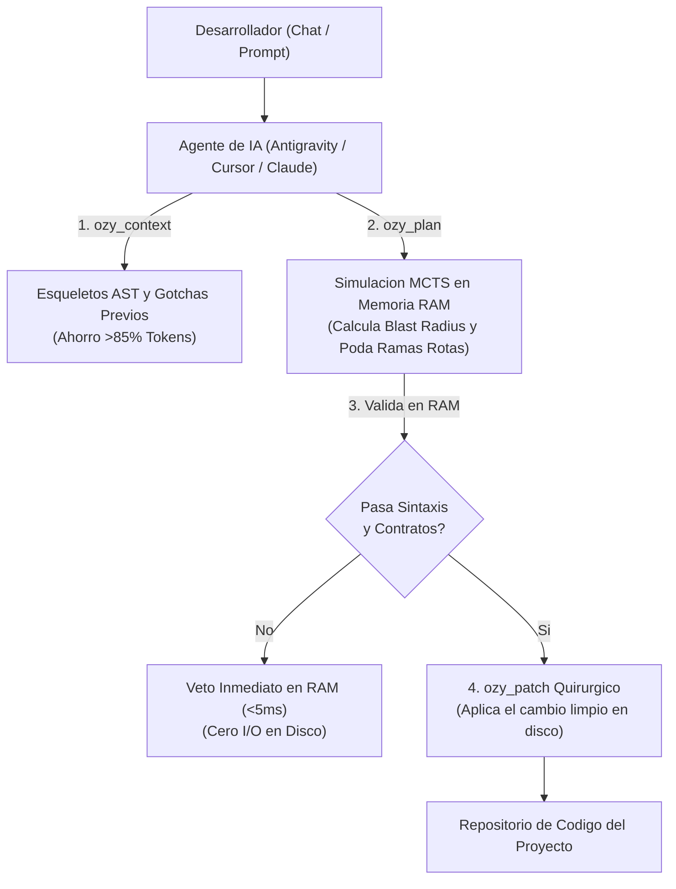
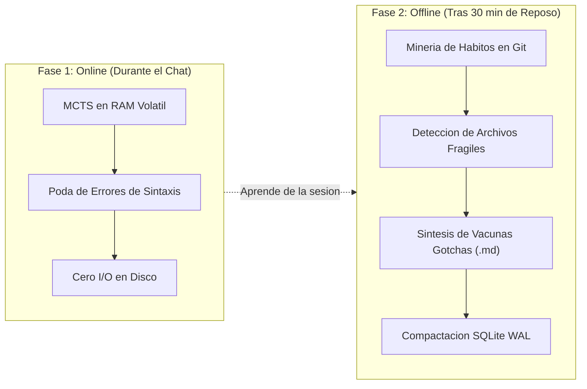

<div align="center">

# Ozygram

### *Memoria Persistente, Grafo de Código y Aprendizaje Autónomo para Agentes de IA*

[](https://github.com/Xangel0s/ozygram/releases)
[](crates/ozymem-core)
[-brightgreen?style=for-the-badge)](docs/changelog.md)
[](docs/herramientas-casos-de-uso.md)
[](https://github.com/Xangel0s/ozygram)
[](LICENSE)

<br/>

<p align="center">
  <a href="docs/herramientas-casos-de-uso.md"><strong>Guia de Herramientas & Prompts</strong></a> &bull;
  <a href="#instalacion-rapida-en-1-minuto"><strong>Instalacion</strong></a> &bull;
  <a href="#como-funciona-visualmente"><strong>Como Funciona</strong></a> &bull;
  <a href="#las-5-meta-herramientas-mcp"><strong>Herramientas MCP</strong></a> &bull;
  <a href="#comandos-de-terminal-cli"><strong>Comandos CLI</strong></a> &bull;
  <a href="docs/INDEX.md"><strong>Docs Hub</strong></a> &bull;
  <a href="docs/changelog.md"><strong>Changelog</strong></a>
</p>

</div>

---

## [QUE ES OZYGRAM EN 30 SEGUNDOS?]

Los agentes de IA convencionales tienen **tres grandes problemas**:
1. **Olvido constante:** Cada nueva conversacion empieza de cero y tropieza con los mismos errores del pasado.
2. **Saturacion de tokens:** Leen archivos completos de miles de lineas solo para modificar una funcion, gastando ventana de contexto y dinero.
3. **Edicion a ciegas:** Aplican parches directo a tus archivos reales; si fallan, rompen dependencias y pierden tiempo debatiendo el error.

**Ozygram** es el sistema operativo de memoria y grafo de codigo que dota a tu agente de:
* **Pruebas en RAM antes de tocar disco:** Simula y valida los cambios en memoria volátil sin arriesgar tus archivos ni dejar residuos en Git.
* **Ahorro de >85% de tokens:** Extrae solo firmas sintacticas (AST) y contratos exportados en lugar de archivos completos.
* **Aprendizaje permanente (Git-First):** Recuerda las convenciones y "gotchas" de tu proyecto directamente en archivos Markdown versionados.

---

## [COMO FUNCIONA VISUALMENTE]

### 1. El Flujo de Trabajo Seguro en Sesion



---

### 2. La Dualidad de OzyDream: Online vs. Offline



---

## [COMPARATIVA: AGENTE COMUN VS. AGENTE CON OZYGRAM]

| Situacion habitual | Agente Comun (Sin Ozygram) | Agente con Ozygram |
| :--- | :--- | :--- |
| **Leer archivos para entender el contexto** | Lee 5 archivos de 1,500 lineas (~20,000 tokens de entrada). | Inyecta solo esqueletos y firmas de funciones (~1,500 tokens). **Ahorro >85%**. |
| **Probar un cambio en una funcion clave** | Sobreescribe el archivo en disco. Si no compila, rompe el proyecto. | Simula el cambio en memoria RAM en $<5\text{ ms}$. Si rompe dependencias, lo descarta. |
| **Bugs recurrentes del proyecto** | Comete el mismo error tecnico cada semana. | Lee advertencias preventivas (`[ALERT: GOTCHA_PREVENTION]`) y aplica la solucion probada. |
| **Pruebas complejas con compilador** | Corre comandos directamente sobre tu arbol de trabajo. | Ejecuta compiladores en un *Worktree Efimero* aislado que se autodestruye al terminar. |

---

## [INSTALACION RAPIDA EN 1 MINUTO]

Ozygram se distribuye como binarios nativos optimizados en Rust.

### Windows (PowerShell)
```powershell
powershell -ExecutionPolicy Bypass -File .\install.ps1
```

### Linux & macOS (Bash)
```bash
chmod +x ./install.sh && ./install.sh
```

### Auto-Configuracion de Editores (MCP)
Una vez instalado, ejecuta el asistente para vincularlo automaticamente a tu editor:
```bash
ozymem init --auto
```
Configura de forma autonoma:
* **Antigravity IDE**
* **Claude Desktop / Code**
* **Cursor**
* **Windsurf**
* **VS Code (Cline / Roo Code / Copilot)**

---

## [LAS 5 META-HERRAMIENTAS MCP (PARA AGENTES)]

El servidor MCP unifica mas de 25 herramientas en **5 meta-herramientas directas**, reduciendo la sobrecarga de tokens en el prompt:

```text
+-------------------+---------------------------------------------------------------------------------+
| Meta-Herramienta  | Que hace y como pedirsela al agente                                             |
+-------------------+---------------------------------------------------------------------------------+
| 1. ozy_plan       | Planificacion topologica con MCTS en RAM. Ordena las ediciones de raiz a hojas.  |
|                   | PROMPT: "Usa ozy_plan para calcular la ruta de edicion y el blast radius."       |
+-------------------+---------------------------------------------------------------------------------+
| 2. ozy_context    | Extrae esqueletos AST (LOD) e inyecta advertencias de archivos fragiles.       |
|                   | PROMPT: "Usa ozy_context con lod='contracts' para revisar las firmas de este modulo."|
+-------------------+---------------------------------------------------------------------------------+
| 3. ozy_patch      | Simula parches en RAM ('simulate') o aplica cambios quirurgicos en disco.       |
|                   | PROMPT: "Simula el cambio con ozy_patch en RAM antes de modificar el archivo."  |
+-------------------+---------------------------------------------------------------------------------+
| 4. ozy_memory     | Guarda lecciones aprendidas en Markdown bajo .ozy/memories/ y busca con RRF.    |
|                   | PROMPT: "Guarda esta solucion en ozy_memory como una convencion del proyecto."   |
+-------------------+---------------------------------------------------------------------------------+
| 5. ozy_doctor     | Linteo de migraciones SQL, salud de la base SQLite WAL y deteccion de cuellos.  |
|                   | PROMPT: "Ejecuta ozy_doctor para auditar la integridad de las migraciones."     |
+-------------------+---------------------------------------------------------------------------------+
```

> Para ver la referencia exhaustiva con parametros, tipos y ejemplos de JSON, consulta la [Guia Maestra de Herramientas y Casos de Uso](docs/herramientas-casos-de-uso.md).

---

## [COMANDOS DE TERMINAL CLI]

Tu tambien puedes inspeccionar y controlar Ozygram directamente desde la terminal con el comando `ozymem`:

| Comando | Descripcion |
| :--- | :--- |
| `ozymem dream status` | Muestra el estado de la politica MCTS activa, constante UCT ($\sqrt{2}$) y limites de observacion. |
| `ozymem dream shadow` | Despliega las metricas del Modo Sombra: factor de ramificacion real, adherencia a los planes y balance de tokens. |
| `ozymem dream run` | Lanza manualmente un ciclo de consolidacion offline (mineria de habitos en Git y vacunas gotchas). |
| `ozymem dream tree` | Exporta el arbol de decisiones explorado por MCTS como diagrama visual Mermaid. |
| `ozymem doctor` | Chequeo general del entorno, dependencias y conexion a la base de datos local. |
| `ozygram serve` | Inicia el servidor MCP de alto rendimiento via stdio para clientes de IA. |

---

## [DOBLE NIVEL DE AISLAMIENTO Y SEGURIDAD]

Para que tengas absoluta tranquilidad al trabajar con agentes autonomos:

1. **Nivel 1: Volatil en Memoria RAM (CoW - Copy-on-Write)**
   * Todo analisis de impacto ocurre en RAM pura (`SANDBOX_INVARIANT_COW_RAM_ONLY`).
   * No escribe archivos temporales ni toca el disco.
   * Si una funcion cambiada deja huerfanos a sus llamadores, se aborta en menos de 5 ms.

2. **Nivel 2: Sandbox Git Worktree Efimero (`EphemeralWorktree`)**
   * Cuando se requiere ejecutar pruebas de compilacion (`pytest`, `cargo`, `npm`, `tsc`), Ozygram crea un worktree temporal aislado basado en `HEAD`.
   * Opera bajo una politica estricta de **Default-Deny** (solo se admiten binarios de prueba verificados; bloquea cualquier comando destructivo).
   * Al finalizar la prueba, el directorio efimero se destruye automaticamente (RAII Drop). Tu rama de trabajo nunca se contamina.

---

## [DOCUMENTACION COMPLETA]

Para profundizar en los detalles tecnicos y arquitectura, visita el directorio [`docs/`](docs/INDEX.md):

* [**Guia Maestra de Herramientas y Casos de Uso**](docs/herramientas-casos-de-uso.md): Referencia operativa de las 5 Meta-Herramientas, prompts practicos y flujo paso a paso.
* [**Arquitectura Tri-Hibrida y Outbox**](docs/architecture.md): L1 SQLite WAL, L2 ChromaDB y L3 PostgreSQL.
* [**Busqueda Semantica y RRF**](docs/semantic-search.md): Fusion de lexico FTS5 (BM25) con embeddings densos ONNX.
* [**Supervision y Blast Radius**](docs/supervision-and-validation.md): Analisis de churn en Git y grafos de dependencia AST.
* [**Sistema de Engramas O(1)**](docs/engram_system.md): Contratos deterministas mapeados en memoria con `rkyv` y `memmap2` (<15 ns).
* [**Dream-RSI & MCTS**](docs/dream-rsi.md): Reproduccion de trayectorias, seleccion UCT y optimizacion de politicas.
* [**Historial de Versiones**](docs/changelog.md): Registro cronologico de mejoras y auditorias.

---

<div align="center">
  <sub>Ozygram &bull; Sistema Operativo de Memoria y Grafo de Codigo para Agentes de IA &bull; Codigo Abierto bajo Licencia MIT</sub>
</div>
