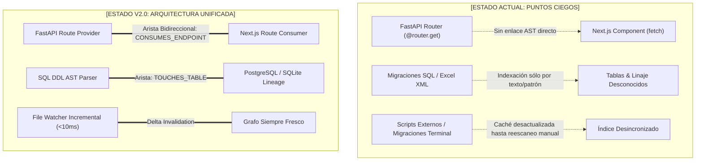
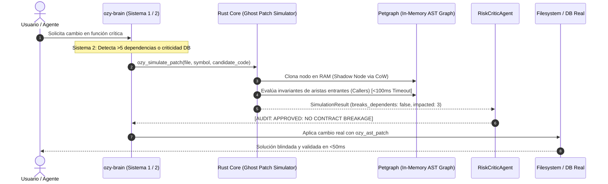

# [PLAN MAESTRO: OZYGRAM V2.0 - EVOLUCIÓN COGNITIVA & HIPER-OPTIMIZACIÓN DE TOKENS]

## 1. Diagnóstico de Puntos Ciegos y Soluciones Arquitectónicas

Actualmente, Ozygram cuenta con una base de alto rendimiento construida en Rust (`ozymem-core`, `ozymem-parser`, `ozymem-server`) y orquestación cognitiva en Python (`ozy-brain`). Sin embargo, en el trabajo diario con arquitecturas full-stack modernas (como FastAPI + Next.js + PostgreSQL), surgen tres puntos ciegos clave:



### [PUNTO CIEGO 1: Frontera Cross-Language (FastAPI ⇄ Next.js)]
* **Límite actual**: El AST de Python y el AST de TypeScript operan de forma aislada. Si se renombra o modifica una ruta (`/api/sig/sctr`), Ozygram depende de `ozy_search_literal` para encontrar las menciones en el frontend.
* **Solución Arquitectónica**:
  - Extender [api_routes.rs](file:///c:/Users/Lenovo/Documents/ozygram/ozygram/crates/ozymem-parser/src/api_routes.rs) para extraer no solo declaraciones del lado servidor (`@router.get(...)`), sino también llamadas del lado cliente (`fetch("/api/...")`, `apiClient.get(...)`, `useQuery(...)`).
  - Registrar un nodo de primer nivel `GraphEntityType::Endpoint` y un tipo de arista dirigida `MemoryEdgeType::EndpointConsumer`.
  - Cuando se altera un endpoint en FastAPI, el grafo resuelve en $O(1)$ la lista exacta de componentes de Next.js afectados sin gastar tokens en búsquedas globales.

### [PUNTO CIEGO 2: Archivos SQL y Migraciones]
* **Límite actual**: Los scripts de migración (ej. `067_clasificar_jinshi_antiguo_silvia.sql`) y estructuras de datos dinámicas se indexan como texto plano.
* **Solución Arquitectónica**:
  - Implementar un extractor estático de DDL en Rust para sentencias `CREATE TABLE`, `ALTER TABLE`, `ADD COLUMN`, `REFERENCES` e `INDEX`.
  - Crear nodos `GraphEntityType::DatabaseTable` y aristas `TouchesTable` conectadas a los modelos de SQLAlchemy/Pydantic en backend y a los endpoints que los exponen.

### [PUNTO CIEGO 3: Invalidación de Caché tras Scripts Externos]
* **Límite actual**: Ejecutar comandos en terminal o scripts ad-hoc fuera de las herramientas MCP puede dejar desfasado el grafo en memoria hasta ejecutar un escaneo explícito.
* **Solución Arquitectónica**:
  - Integrar el crate `notify` en `ozymem-server` / `ozymem-cli` para un watcher asíncrono de eventos de filesystem.
  - Al detectar `Modify(Path)` o `Create(Path)`, se dispara un análisis delta en segundo plano (< 10 ms por archivo) invalidando únicamente el subgrafo afectado.

---

## 2. Las 5 Mejoras de Hiper-Optimización de Tokens

El principio rector es la **Divulgación Progresiva (Progressive Disclosure)**: el agente nunca debe pagar el costo de tokens de la implementación completa de un archivo cuando solo necesita comprender su contrato o relación en el sistema.

```
+-----------------------------------------------------------------------------------------+
|                                    NIVELES DE DETALLE (LOD)                             |
|                                                                                         |
|  [LOD 0: MACRO]   -> Módulos, dependencias entre proyectos y rutas HTTP (50 tokens)     |
|  [LOD 1: INTERFAZ]-> Skeleton: Imports, Interfaces, Tipos, Firmas y Docstrings (250 tkn)|
|  [LOD 2: MICRO]   -> Cuerpo AST completo de la función puntual a modificar (400 tokens) |
+-----------------------------------------------------------------------------------------+
```

### 1. "Skeletonization" / Podado de AST (Ahorro: 75% - 90%)
* **Mecanismo**: En [exploration.rs](file:///c:/Users/Lenovo/Documents/ozygram/ozygram/crates/ozymem-core/src/graph_backend/exploration.rs) y [symbols.rs](file:///c:/Users/Lenovo/Documents/ozygram/ozygram/crates/ozymem-server/src/symbols.rs), implementar la función `view_skeleton(file_path)`.
* **Transformación**:
  ```typescript
  // En vez de 120 líneas de lógica interna por método:
  export async function recalcularVidaLey(req: RecalculoRequest): Promise<RecalculoResult> {
      /* [omitted 118 lines: business logic, db transaction, validations] */
  }
  ```
* **Beneficio**: El agente recibe el 100% de la semántica, tipos de parámetros, tipos de retorno y contratos sin saturar el contexto con código que no va a editar.

### 2. Niveles de Detalle en el Grafo (LOD en `schema.rs`)
* **LOD 0**: Vista arquitectónica macro (ej. `crm-geofal/VerificacionForm.tsx` -> `api-geofal-crm/routers/verificaciones.py`).
* **LOD 1**: Vista de contratos de símbolos (Skeleton de tipos y exports).
* **LOD 2**: Cuerpo AST detallado.
* **Comportamiento por Defecto**: Las herramientas `ozy_context` y `ozy_exploration` devuelven LOD 0 y 1. LOD 2 solo se consulta bajo demanda explícita para el símbolo a editar (`ozy_get_symbol`).

### 3. Extractive Context vs Chunking Estático en `embeddings.rs`
* **Mecanismo**: La búsqueda semántica tradicional inyecta chunks arbitrarios de 512 o 1024 tokens.
* **Mejora**: Tras calcular el match vectorial en [embeddings.rs](file:///c:/Users/Lenovo/Documents/ozygram/ozygram/crates/ozymem-core/src/graph_backend/embeddings.rs), se aplica una ventana extractiva de $\pm 10$ líneas centrada en la máxima densidad de coincidencia semántica y de palabras clave.
* **Reducción**: De 2,500 tokens por consulta semántica a ~300 tokens de contexto hiperquirúrgico.

### 4. Aristas Cross-Language Automáticas en el Grafo
* **Mecanismo**: Generación de aristas `EdgeType::EndpointConsumer` entre funciones TS/TSX y routers FastAPI.
* **Beneficio**: Elimina los comandos exploratorios `grep_search` repetitivos. Cuando se altera una firma en el backend, el sistema sabe de inmediato los archivos frontend a auditar.

### 5. Deduplicador de Sesión en `ozymem-server`
* **Mecanismo**: En [state.rs](file:///c:/Users/Lenovo/Documents/ozygram/ozygram/crates/ozymem-server/src/state.rs), almacenar el set de hashes de los nodos ya emitidos durante la sesión activa.
* **Respuesta**: Si un símbolo ya fue cargado previamente y su SHA-256 no ha cambiado, se emite una referencia compacta:
  `[STATUS: CACHED_IN_CONTEXT: Symbol 'fetchRecepcion' (sha256: d8f3a1), unchanged]`.
* **Beneficio**: Evita el inflado exponencial del historial de conversación en tareas de 15 o más turnos.

---

## 3. Salto Cognitivo: Razonamiento Contrafactual, DreamRSI y Sistema Dual



### [INNOVACIÓN 1: Speculative AST Patching ("Ghost Patching" en RAM)]
* **Problema**: Los asistentes convencionales modifican archivos a ciegas y esperan a que el compilador o el usuario reporten errores de regresión.
* **Solución**:
  1. Nueva función en Rust: `pub fn simulate_patch(&self, target_symbol: &str, candidate_code: &str) -> SimulationResult`.
  2. Duplica en memoria RAM el nodo del símbolo objetivo sin tocar disco ni SQLite.
  3. Parsea el código candidato con Tree-Sitter y revisa las aristas entrantes (`Incoming Edges`):
     - ¿Se alteró la cantidad de argumentos esperados?
     - ¿Se rompió el tipo de retorno requerido por los llamantes?
  4. Retorna el veredicto en menos de **15 milisegundos**.
* **Herramienta MCP**: `ozy_simulate_patch` permite que el agente auto-corrija su código internamente antes de mostrarlo al usuario.
* **Garantía Estricta de Aislamiento del Ghost Simulator (Sandbox Invariant Contract)**:
  - **Copy-on-Write (Cow)**: Todo el árbol AST y nodos clonados residen exclusivamente en memoria RAM volátil (`petgraph`). Cero escrituras en SQLite ni en disco.
  - **Timeout Duro (100 ms)**: Límite estricto de reloj de CPU. Si la simulación de aristas o tipos excede 100 ms, se cancela automáticamente y retorna `risk: UNKNOWN_TIMEOUT` sin bloquear el hilo principal ni congelar el servidor.
  - **Cero I/O**: Prohibición arquitectónica absoluta de abrir sockets de red, llamadas a subprocesos o accesos de I/O a disco durante el ciclo de simulación.

### [INNOVACIÓN 2: Arquitectura Cognitiva de Doble Sistema (Kahneman)]
* **Sistema 1 (Reflejo Rápido / Intuición - < 150 ms)**:
  - Operaciones rutinarias (imports, corrección de tipografía, inspección de firma única).
  - Ejecución directa sin sobrecosto de pensamiento ni agentes intermedios.
* **Sistema 2 (Deliberación Profunda / Comité Dialéctico)**:
  - Se activa ante operaciones de alto riesgo: migraciones SQL, modificaciones en esquemas de datos o funciones con más de 5 nodos dependientes.
  - **Comité Dialéctico de 3 Agentes en `ozy-brain`**:
    1. **Implementador**: Propone la solución inicial más eficiente.
    2. **Abogado del Diablo (`risk_critic.py`)**: Busca activamente casos borde, condiciones de carrera y desbordamientos.
    3. **Juez Ejecutivo**: Sintetiza ambas posturas y valida con `ozy_simulate_patch` antes de emitir la versión final.

### [INNOVACIÓN 3: Consolidación Offline en Tiempo Ocioso (DreamRSI)]
* **El Sueño Cognitivo**:
  - Tras 30 minutos de inactividad del desarrollador, DreamRSI ejecuta una consolidación en segundo plano en modo `Read-Only` estricto sobre el código fuente.
  - **Destilación de Trazas**: Agrupa observaciones y correcciones del día en lecciones de memoria definitivas (`kind: 'convention' | 'gotcha'`).
  - **Memory Decay (Decaimiento de Memoria)**: Aplica una función de atenuación temporal a notas efímeras no consultadas en más de 7 días, evitando la saturación del vector store y SQLite.
* **Auto-Calibración de `risk_critic.py` (True RSI)**:
  - Cada vez que un diff causa una reversión manual o un fallo de linter, DreamRSI lo registra como un contraejemplo de entrenamiento, ajustando los umbrales de severidad automáticamente para evitar repetir el mismo error.

### [INNOVACIÓN 4: "Vacunación Automática contra Regresiones" (Postmortem-to-Invariant en Dream)]
* **El Problema**: Casos reales donde un cálculo normativo (Vida Ley) o clasificación de clientes (Jinshi) genera fricciones y regresiones que se repiten semanas después.
* **El Mecanismo de Vacunación**:
  - Cuando DreamRSI detecta un commit con prefijo `fix:` o un `git revert`, analiza automáticamente el diff y el contexto del fallo para extraer la causa raíz.
  - Inyecta un **nodo invariante permanente** en el grafo de conocimiento de `schema.rs`:
    `INVARIANT[control_probetas.costo_servicio]: NEVER OVERWRITE WITH COTIZACION_TOTAL`
    `INVARIANT[vida_ley.recalculo]: MUST PRESERVE BASE_CALCULO`
* **Veto Obligatorio en `risk_critic.py`**:
  - A partir de ese momento, ningún agente ni desarrollador puede proponer un cambio que viole esa regla sin que `risk_critic.py` salte instantáneamente con un veto crítico:
    `[CRITICAL_VETO: INVARIANT_VIOLATION: Rule 'NEVER OVERWRITE WITH COTIZACION_TOTAL' violated in line 42]`.
  - Convierte cada error histórico en una vacuna permanente e inmutable.

### [INNOVACIÓN 5: Telemetría y Contabilidad de Tokens en Tiempo Real (`ozymem stats`)]
* **Visibilidad Cuantitativa del Valor Tangible**:
  - Comando CLI ligero `ozymem stats` para consultar el rendimiento y ahorro de recursos de la sesión activa:
    ```text
    [OZYMEM METRICS - SESSION 2026-10-13]
    • Tokens Ahorrados Hoy: 142,350 tokens (~81.4% de reducción vía Skeletons)
    • Ghost Patches Simulados: 18 (2 regresiones bloqueadas antes de tocar disco)
    • Nodos en Grafo: 3,420 | Aristas Cross-Language (API ⇄ UI): 184
    • Nodos Podados por Dream (Memory Decay): 46 notas efímeras archivadas
    • Invariantes Activas (Vacunas): 12 reglas blindadas contra regresiones
    ```
  - Permite auditar cuantitativamente el retorno de inversión técnica en cada jornada de desarrollo.

---

## 4. Análisis Cuantitativo de Viabilidad e Impacto

### Métricas de Consumo de Tokens (Comparativa Directa)

| Operación / Flujo | Enfoque Convencional | Con Ozygram v2.0 | Reducción de Tokens |
| :--- | :--- | :--- | :--- |
| **Exploración de Módulo (10 archivos)** | ~25,000 tokens (código completo) | ~2,800 tokens (LOD 1 / Skeletons) | **-88.8%** |
| **Búsqueda Semántica de Símbolos** | ~2,500 tokens (3 chunks fijos) | ~350 tokens (Ventana extractiva) | **-86.0%** |
| **Sesión Conversacional de 15 Turnos** | ~45,000 tokens (eco de símbolos) | ~11,000 tokens (Deduplicación/Hashes)| **-75.5%** |
| **Navegación Cross-Language (API ⇄ UI)**| ~6,000 tokens (greps globales) | ~120 tokens (Arista directa del Grafo)| **-98.0%** |
| **Verificación de Regresiones** | ~8,000 tokens (múltiples lecturas) | ~150 tokens (`ozy_simulate_patch` en RAM)| **-98.1%** |
| **TOTAL PROMEDIO POR DÍA** | **~180,000 tokens** | **~35,000 tokens** | **~80.5% AHORRO GLOBAL** |

### Factibilidad Técnica por Componente

| Componente | Complejidad | Factibilidad | Dependencias Clave Existentes |
| :--- | :---: | :---: | :--- |
| **AST Skeletonization** | Media | **9.5 / 10** | Tree-Sitter en `ozymem-parser`, query grammar ya operativa. |
| **LOD en Graph Engine** | Baja | **9.8 / 10** | `petgraph`, filtros en `schema.rs` y `exploration.rs`. |
| **Extractive Context Windowing**| Baja | **9.8 / 10** | `embeddings.rs`, slice de líneas sobre match index. |
| **Cross-Language Endpoints** | Media | **9.2 / 10** | `api_routes.rs` ya tiene bases para FastAPI/Express. |
| **Ghost Patch Simulator (Cow/100ms)** | Media-Alta | **9.0 / 10** | `petgraph` en RAM, `extract_ast_diagnostics` en memoria. |
| **Session Deduplicator & Stats CLI** | Baja | **9.9 / 10** | `HashSet` de hashes en `state.rs`, comando CLI en `ozymem-cli`. |
| **File Watcher Incremental** | Media | **9.4 / 10** | Crate `notify` en Rust, escaneo delta en `indexing.rs`. |
| **DreamRSI Postmortem Invariant** | Media | **8.9 / 10** | `git_backend.rs`, `outbox_consumer.py`, `evaluator.py`. |

---

## 5. Matriz de Fases y Tareas Auditables (4 Fases x 4 Tareas)

### [FASE 5: Token Hyper-Optimization & AST Skeletonization]
*Objetivo: Maximizar la densidad de información y reducir el consumo de tokens en lecturas exploratorias y búsquedas semánticas.*

- [x] **Task 5.1: Implementación de `view_skeleton` en Rust Core**
  - **Componentes**: `crates/ozymem-parser/src/lib.rs`, `crates/ozymem-server/src/symbols.rs`.
  - **Descripción**: Crear función de podado de AST que preserve imports, interfaces, types, signatures de métodos/funciones y docstrings, reemplazando el bloque del cuerpo (`body`) por un marcador compacto `/* [omitted N lines] */`.
  - **Criterio de Aceptación**: `cargo test -p ozymem-parser` valida que un archivo TypeScript de 500 líneas se reduzca a un esqueleto sintácticamente válido de < 60 líneas con reducción de tokens > 80%. [STATUS: COMPLETED]

- [x] **Task 5.2: Modos de Nivel de Detalle (LOD 0, 1, 2) en `exploration.rs` y `schemas.rs`**
  - **Componentes**: `crates/ozymem-server/src/unified.rs`, `crates/ozymem-server/src/exploration.rs`, `crates/ozymem-server/src/schemas.rs`.
  - **Descripción**: Parametrizar las herramientas `ozy_context` y `ozy_exploration` con el flag `lod: "macro" | "contracts" | "full"`. Configurar `lod: "contracts"` como valor por defecto para respuestas ligeras.
  - **Criterio de Aceptación**: Consultas con `lod: "contracts"` devuelven contratos sin cuerpos de métodos, reduciendo el payload de tokens a menos de un tercio. [STATUS: COMPLETED]

- [x] **Task 5.3: Ventana Extractiva para Búsqueda Semántica en `embeddings.rs`**
  - **Componentes**: `crates/ozymem-core/src/graph_backend/embeddings.rs`, `crates/ozymem-core/src/graph_backend/types.rs`, `crates/ozymem-server/src/memory.rs`.
  - **Descripción**: Reemplazar la inyección de chunks estáticos de 1024 tokens por un recortador que calcule el offset del match más cercano y extraiga una ventana contextual de $\pm 10$ líneas acompañada de la ruta del archivo y los números de línea exactos.
  - **Criterio de Aceptación**: Resultados de búsqueda semántica devuelven snippets precisos de 20-30 líneas en lugar de archivos o bloques completos. [STATUS: COMPLETED]

- [x] **Task 5.4: Deduplicador de Sesión y Telemetría de Tokens (`ozymem stats`)**
  - **Componentes**: `crates/ozymem-server/src/state.rs`, `crates/ozymem-server/src/symbols.rs`, `crates/ozymem-cli/src/commands/stats.rs`.
  - **Descripción**: Mantener en la sesión activa un conjunto de hashes SHA-256 de los símbolos entregados para responder con `[STATUS: CACHED_IN_CONTEXT]` ante peticiones redundantes. Implementar el comando CLI `ozymem stats` que reporte tokens ahorrados, ghost patches simulados, regresiones evitadas y estado de memoria.
  - **Criterio de Aceptación**: `ozymem stats` reporta métricas cuantitativas en tiempo real y peticiones repetidas consumen < 30 tokens por referencia. [STATUS: COMPLETED]

---

### [FASE 6: Frontera Cross-Language & Unificación Políglota]
*Objetivo: Conectar semánticamente FastAPI, Next.js y bases de datos SQL eliminando la necesidad de búsquedas ciegas.*

- [x] **Task 6.1: Extractor de Consumidores de Endpoints en Next.js/TSX**
  - **Componentes**: `crates/ozymem-parser/src/api_routes.rs`, `crates/ozymem-parser/src/lib.rs`.
  - **Descripción**: Implementar `parse_frontend_endpoint_consumers` para detectar llamadas a endpoints vía `fetch("/api/...")`, `axios.get/post(...)`, `apiClient.get/post(...)` y hooks reactivos (`useQuery`, `useSWR`), extrayendo el path de la URL y el método HTTP.
  - **Criterio de Aceptación**: Pruebas unitarias en `api_routes.rs` detectan llamadas en componentes de Next.js como `VerificacionForm.tsx` y las asocian a su ruta canónica. [STATUS: COMPLETED]

- [x] **Task 6.2: Aristas Bidireccionales `CONSUMES_ENDPOINT` en el Grafo**
  - **Componentes**: `crates/ozymem-core/src/graph_backend/schema.rs`, `memory_graph.rs`, `types.rs`, `crates/ozymem-server/src/unified.rs`.
  - **Descripción**: Crear la entidad `GraphEntityType::Endpoint` y el tipo de arista `MemoryEdgeType::ConsumesEndpoint`. Durante el indexado, enlazar automáticamente los endpoints de Python/FastAPI con los componentes TSX de Next.js que los consumen.
  - **Criterio de Aceptación**: Una consulta a `ozy_graph(action="endpoint_dependents", endpoint="/api/sig/sctr")` devuelve en < 5 ms la lista exacta de componentes frontend vinculados y definiciones backend. [STATUS: COMPLETED]

- [x] **Task 6.3: Extractor de Linaje DDL para Migraciones SQL**
  - **Componentes**: `crates/ozymem-parser/src/sql_ddl.rs`, `crates/ozymem-core/src/graph_backend/memory_graph.rs`, `crates/ozymem-server/src/unified.rs`.
  - **Descripción**: Parsear archivos `.sql` extrayendo nombres de tablas creadas o modificadas (`CREATE TABLE`, `ALTER TABLE`, `REFERENCES`), registrando entidades `GraphEntityType::DatabaseTable` y aristas `TouchesTable` conectadas a los modelos del backend (SQLAlchemy, SQLModel, Drizzle, Prisma).
  - **Criterio de Aceptación**: `ozy_graph(action="table_lineage", table="control_probetas")` devuelve la historia DDL completa de migraciones y modelos ORM vinculados en < 10 ms. [STATUS: COMPLETED]

- [ ] **Task 6.4: Invalidador Incremental de Caché con Watcher de Filesystem**
  - **Componentes**: `crates/ozymem-server/src/main.rs`, `crates/ozymem-core/src/graph_backend/indexing.rs`.
  - **Descripción**: Incorporar un watcher basado en el crate `notify` que capture modificaciones en disco generadas por terminal o scripts externos, ejecutando un re-análisis incremental en memoria del archivo afectado sin bloquear el servidor.
  - **Criterio de Aceptación**: Modificar un archivo fuera del editor actualiza el grafo y los símbolos en < 50 ms sin necesidad de reescaneo manual completo. [STATUS: PLANNED]

---

### [FASE 7: Razonamiento Contrafactual & Simulación Especulativa (Ghost Patching)]
*Objetivo: Validar los cambios de código en un sandbox virtual de AST en RAM antes de tocarlos en disco.*

- [ ] **Task 7.1: Motor de Clonación Efímera en RAM con Contrato Sandbox Invariant**
  - **Componentes**: `crates/ozymem-core/src/graph_backend/queries.rs`, `types.rs`.
  - **Descripción**: Implementar `simulate_patch(&self, target_symbol: &str, candidate_code: &str) -> SimulationResult` bajo el contrato estricto de aislamiento: Copy-on-Write en RAM volátil (`petgraph`), timeout duro de 100 ms (retornando `UNKNOWN_TIMEOUT` en caso de excederse) y cero accesos a disco o sockets de red.
  - **Criterio de Aceptación**: La simulación de reemplazo de un método se ejecuta en < 15 ms en RAM y se cancela con seguridad si sobrepasa 100 ms. [STATUS: PLANNED]

- [ ] **Task 7.2: Verificador de Invariantes de Aristas Entrantes (Callers)**
  - **Componentes**: `crates/ozymem-core/src/graph_backend/queries.rs`.
  - **Descripción**: Al simular una mutación de un símbolo, recorrer todas las aristas entrantes (`Incoming Callers`) y comprobar si los llamantes siguen cumpliendo con la cantidad de argumentos requeridos y compatibilidad de tipos devuelta.
  - **Criterio de Aceptación**: Si una mutación elimina un argumento obligatorio usado por 3 componentes, el simulador reporta `breaks_dependents: true` con la lista de nodos incompatibles. [STATUS: PLANNED]

- [ ] **Task 7.3: Herramienta MCP `ozy_simulate_patch` para Agentes**
  - **Componentes**: `crates/ozymem-server/src/symbols.rs`, `src/dispatch.rs`, `src/schemas.rs`.
  - **Descripción**: Exponer la herramienta MCP `ozy_simulate_patch(file_path, symbol_name, candidate_code)`. Los agentes de programación la invocan como paso pre-vuelo antes de `ozy_ast_patch` o `replace_file_content`.
  - **Criterio de Aceptación**: La herramienta retorna `SimulationResult` en formato JSON estructurado con nivel de riesgo (`LOW`, `MEDIUM`, `CRITICAL`). [STATUS: PLANNED]

- [ ] **Task 7.4: Loop de Auto-Calibración en `risk_critic.py` y Veto de Invariantes**
  - **Componentes**: `python/ozy-brain/ozy_brain/agents/risk_critic.py`, `python/ozy-brain/ozy_brain/dream/evaluator.py`.
  - **Descripción**: Registrar en SQLite los rollbacks y fallos de ejecución como eventos de retroalimentación negativa. `risk_critic.py` lee estos contraejemplos y los nodos `INVARIANT[...]` del grafo, emitiendo un bloqueo preventivo `[CRITICAL_VETO: INVARIANT_VIOLATION]` si una propuesta viola una regla histórica vacunada.
  - **Criterio de Aceptación**: Propuestas de código que violen invariantes registradas son vetadas en < 5 ms con mensaje explicativo. [STATUS: PLANNED]

---

### [FASE 8: Arquitectura Cognitiva de Doble Sistema & DreamRSI Offline]
*Objetivo: Integrar el procesamiento por reflejo rápido vs deliberación profunda y la consolidación de conocimiento en tiempo ocioso.*

- [ ] **Task 8.1: Router Cognitivo Sistema 1 (Reflejo) vs Sistema 2 (Deliberativo)**
  - **Componentes**: `python/ozy-brain/ozy_brain/brain.py`, `planner.py`.
  - **Descripción**: Implementar un clasificador ultraligero que despache tareas mecánicas (imports, tipografías, formato) al Sistema 1 (< 150 ms, sin llamadas a LLM deliberativo), reservando el razonamiento multi-agente del Sistema 2 únicamente para cambios con alto blast radius o mutaciones de base de datos.
  - **Criterio de Aceptación**: Tareas triviales se resuelven en < 200 ms con cero tokens de razonamiento extra. [STATUS: PLANNED]

- [ ] **Task 8.2: Comité Dialéctico de 3 Agentes en `ozy-brain`**
  - **Componentes**: `python/ozy-brain/ozy_brain/agents/supervisor.py`, `risk_critic.py`.
  - **Descripción**: Configurar la interacción dialéctica: Agente Implementador (propuesta) -> Agente Crítico (búsqueda de fallos) -> Juez Ejecutivo (síntesis y validación con `ozy_simulate_patch`), entregando una respuesta unificada y blindada.
  - **Criterio de Aceptación**: Cambios críticos pasan por la auditoría interna antes de presentarse al usuario. [STATUS: PLANNED]

- [ ] **Task 8.3: Consolidación Offline en Tiempo Ocioso (Sleep Daemon, Memory Decay & Postmortem Vaccine)**
  - **Componentes**: `python/ozy-brain/ozy_brain/dream/optimizer.py`, `crates/ozymem-core/src/graph_backend/schema.rs`.
  - **Descripción**: Implementar el ciclo de consolidación nocturno o en tiempo ocioso:
    1. Agrupación y destilación de observaciones efímeras del día en lecciones consolidadas.
    2. Algoritmo de decaimiento temporal (`memory decay`): atenuar y archivar notas temporales de baja confianza no consultadas en más de 7 días.
    3. Vacunación Postmortem: detección de commits `fix:` y `git revert` para inyectar nodos `INVARIANT[...]` en el grafo.
  - **Criterio de Aceptación**: `ozymem dream run` purga memorias huérfanas, comprime el grafo e inyecta invariantes de regresiones detectadas. [STATUS: PLANNED]

- [ ] **Task 8.4: Consumidor Proactivo Outbox Conectado a Diagnósticos de IDE**
  - **Componentes**: `python/ozy-brain/ozy_brain/outbox_consumer.py`.
  - **Descripción**: Conectar el `UniversalOutbox` a los eventos de diagnóstico de Tree-Sitter / TypeScript en tiempo real. Cuando se detecta un error de sintaxis o tipo en el workspace, el consumidor genera de forma proactiva la sugerencia de reparación antes de que el usuario la solicite.
  - **Criterio de Aceptación**: Eventos en la tabla `outbox_events` con tipo `DIAGNOSTIC_ERROR` generan recomendaciones contextuales pre-calculadas en menos de 1 segundo. [STATUS: PLANNED]

---

## 6. Protocolo de Ejecución y Estándares de Ingeniería

1. **Desarrollo Incremental Atómico**: Cada tarea se implementa individualmente, acompañada de sus respectivas pruebas unitarias (Rust `cargo test` y Python `pytest`).
2. **Estándar Zero-Emoji**: Todos los logs, diagramas, commits y salidas de herramientas deben utilizar identificadores textuales normalizados (`[STATUS: PLANNED]`, `[ALERT: CONTRACT_BREAK]`, `[AUDIT: APPROVED]`, `[CRITICAL_VETO: INVARIANT_VIOLATION]`).
3. **No-Regresión en Producción**: Toda mutación sobre tablas de base de datos o lógica de negocio sensible debe ejecutarse primero en el simulador virtual (`ozy_simulate_patch`).
4. **Respeto a Convenciones SOLID, DRY y KISS**: Los componentes nuevos deben reutilizar la infraestructura existente de `ozymem-core` (`petgraph`, SQLite WAL mode) y `UniversalOutbox` sin sobreingeniería redundante.
