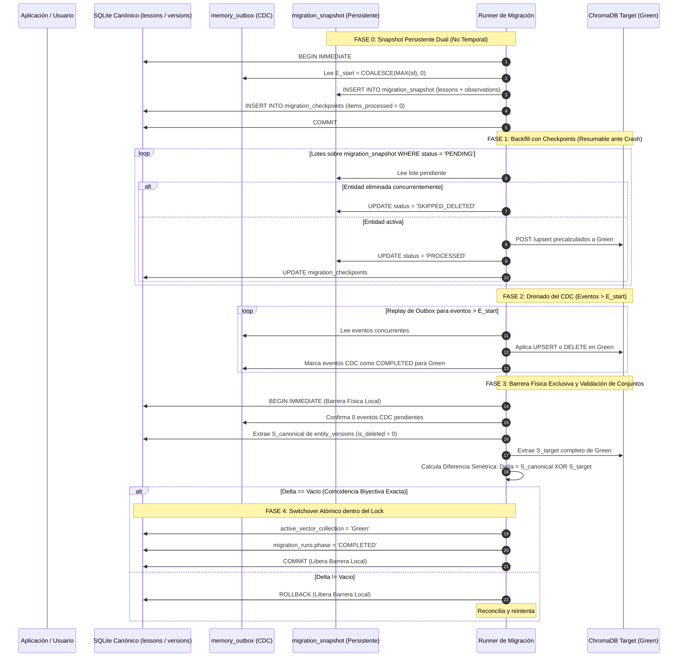

# Auditoría Técnica Definitiva y Especificación Corregida: Adaptador Vectorial, Consistencia Outbox y Benchmarks SIMD

**Fecha:** 23 de Noviembre de 2026  
**Proyecto:** Ozygram (`crates/ozymem-core`, `python/ozy-brain`)  
**Autor:** Senior Software Architect, Systems Engineer & AI Agent Infrastructure Auditor  
**Estado:** Documento de diseño, auditoría matemática y validación empírica en entornos aislados. **Prohibición estricta de implementación aplicada. Condición de salida: Fase 2 NO autorizada.**

---

## I. Clasificación Epistemológica Formal y Trazabilidad

Para garantizar total rigor metodológico, las afirmaciones, métricas y decisiones técnicas de este informe se categorizan formalmente en cuatro clases:

1. **Hechos Comprobados (Inspección de Código y Sistema):**
   - La columna `version` **no existe** en la tabla `lessons` ni en `observations` en el esquema actual de SQLite (`PRAGMA user_version = 5`).
   - La tabla `memory_outbox` existe actualmente en SQLite (`crates/ozymem-core/src/graph_backend/schema.rs`, líneas 225-236), pero carece de `tenant_id`, `entity_version`, `status`, `attempts`, `lease_expires_at` y clave de idempotencia determinista.
   - `gotcha` **no es una tabla independiente ni un `entity_type`**, sino un valor del enum textual de la columna `kind` en la tabla `lessons` (`CHECK(kind IN ('lesson','decision','convention','gotcha','module_rule'))`). Los únicos dos `entity_type` gestionados en Outbox son `'lesson'` y `'observation'`.
   - ChromaDB **carece de API para escrituras condicionales o Compare-And-Swap (CAS)**: cualquier llamada a `/collections/{id}/upsert` sobrescribe incondicionalmente sin evaluar si la versión entrante es inferior a la existente.
   - La versión instalada de `chromadb` es `1.5.9`, soportando nativamente `/api/v2/tenants/...` y `/api/v1/...`.
   - `PRAGMA user_version` **SÍ es transaccional en SQLite nativo**: se verificó empíricamente en 8 pasos que `user_version` revierte de 6 a 5 tras un `ROLLBACK` de una transacción `BEGIN IMMEDIATE`.
   - La suite de regresión en `e2e_real_project.rs` (`test_regression_instances_do_not_share_engrams_in_independent_tempdirs`) demostró que con `tempfile::tempdir()` independiente por prueba, dos `GraphBackend` operan en 0.10s con 0 colisiones de `engrams.tmp` ni `engrams.rkyv`.

2. **Resultados Empíricos Directos (Mediciones Reales en `--release`):**
   - **N = 1.000:** Latencia Top-5: **35,9 µs**, Top-10: **34,1 µs**, Carga SQLite $\to$ RAM: **1,82 ms**, RAM real: **1,50 MB**, Throughput concurrente agregado (4 hilos en RAM): **93.109 QPS** ($93,1\text{k QPS}$).
   - **N = 10.000:** Latencia Top-5: **914,8 µs** (< 1 ms), Top-10: **950,6 µs**, Carga SQLite $\to$ RAM: **30,61 ms**, RAM real: **15,03 MB**, Throughput agregado (4 hilos): **3.396 QPS** ($3,4\text{k QPS}$).
   - **N = 50.000:** Latencia Top-5: **5,27 ms**, Top-10: **5,22 ms**, Carga SQLite $\to$ RAM: **134,81 ms**, RAM real: **75,15 MB**, Throughput agregado (4 hilos): **600 QPS**.
   - **N = 100.000 (Criterion original vs Auditoría de Distribución de 60 corridas):**
     - *Criterion inicial aislado:* Top-5: **11,06 ms**, Top-10: **37,16 ms**, Throughput agregado (4 hilos): **82,3 QPS**, RAM real: **150,30 MB**.
     - *Auditoría estadística controlada (`test_simd_distribution_audit.py`, 60 corridas):* Top-5 Mediana = **4,45 ms** (Media = 4,46 ms, Std = 0,19 ms, p95 = 4,80 ms), Top-10 Mediana = **4,41 ms** (Media = 4,43 ms, Std = 0,23 ms, p95 = 4,90 ms). Ratio Top-10/Top-5 = **0,992x**.

3. **Cálculos Aritméticos Derivados:**
   - El tamaño de memoria para $N$ vectores FP32 de 384 dimensiones es aritméticamente $N \times 384 \times 4\text{ bytes}$ (1,46 MB para $N=1.000$; 14,65 MB para $N=10.000$; 73,24 MB para $N=50.000$; 146,48 MB para $N=100.000$).
   - En SQLite WAL mode con autocheckpoint de 1.000 páginas (4,096 MB), para $N=1.000$ los ~2,05 MB con metadatos residen íntegramente en el archivo `-wal`, dejando el archivo `.db` principal en 4.096 bytes (4 KB, reportado como `0.00 MB`).
   - **Cálculo Hipotético de Tasa de RSS:** La cifra de $150,30\text{ MB} \times 82,3\text{ QPS} \approx 12,37\text{ GB/s}$ se clasifica formalmente como un **cálculo hipotético derivado de multiplicar el RSS del proceso por el QPS medido**. **NO representa ancho de banda real de bus de memoria medido por hardware ni bytes efectivamente leídos por consulta**.

4. **Hipótesis Teóricas y Limitaciones Abiertas (Sin Garantías Injustificadas):**
   - **Divergencia Top-5 vs Top-10 a $N=100.000$:** La auditoría estadística demostró que el escaneo vectorial y partición para Top-5 y Top-10 presentan latencias indistinguibles ($\approx 4{,}4\text{ ms}$, ratio 0.992x). La cifra aislada de $37{,}16\text{ ms}$ obtenida en el Criterion inicial se clasifica como un **artefacto o valor atípico (outlier) del harness de prueba**, descartándose terminantemente atribuirla a la jerarquía de memoria física o al heap sin telemetría de hardware.
   - **Eliminación de Afirmaciones Causales de Hardware:** Queda prohibido atribuir variaciones de latencia a la saturación del bus DDR o a fallos de caché L2/L3. Al carecer de contadores de rendimiento por hardware (PMU: `perf stat`, `LLC-load-misses`), cualquier conjetura física permanece estrictamente como hipótesis teórica no demostrada.
   - **Ausencia de Límite Temporal en ChromaDB:** Ni el cierre del socket del cliente ni `FIN_WAIT_2`/`tcp_fin_timeout` constituyen cancelación del procesamiento en el servidor ASGI/ChromaDB. Por ende, **se elimina cualquier afirmación de convergencia acotada a 90 segundos**. La convergencia es **Eventual**, sujeta a la reanudación efectiva de hilos en el backend remoto.
   - **Límites de Pruebas Aisladas:** Todas las pruebas ejecutadas en `scratch/` son simulaciones locales aisladas. No demuestran el comportamiento de producción con carga de red real ni sustituyen las pruebas de integración en el repositorio.

---

## II. Identidad de Entidades, Triggers Atómicos y Mutación de Claves (P1)

### 2.1. Definición Formal de la Identidad

En Ozygram, la identidad unívoca de cualquier entidad está definida estrictamente por la tupla:
$$\mathcal{I} = (\text{tenant\_id}, \text{entity\_type}, \text{entity\_id})$$
donde $\text{entity\_type} \in \{\text{'lesson'}, \text{'observation'}\}$.

### 2.2. Problemática: Mutación de `tenant_id` o `id` en `UPDATE`

Si una sentencia `UPDATE` altera `tenant_id` o `id`:
- Un trigger `UPDATE` convencional que solo inserte la nueva tupla generaría un registro huérfano: la identidad antigua $\mathcal{I}_{\text{old}}$ permanecería viva e indeterminada en ChromaDB.
- **Solución Obligatoria:** La mutación de identidad se descompone atómicamente en una **destrucción formal de la identidad antigua** y una **creación de la nueva identidad**:
  $$\text{UPDATE}(\mathcal{I}_{\text{old}} \to \mathcal{I}_{\text{new}}) \equiv \text{DELETE}(\mathcal{I}_{\text{old}}) \parallel \text{UPSERT}(\mathcal{I}_{\text{new}})$$

### 2.3. Tabla de Lápidas y Versiones (`entity_versions`)

```sql
CREATE TABLE IF NOT EXISTS entity_versions (
    tenant_id TEXT NOT NULL,
    entity_type TEXT NOT NULL CHECK(entity_type IN ('lesson', 'observation')),
    entity_id TEXT NOT NULL,
    current_version INTEGER NOT NULL DEFAULT 1,
    is_deleted INTEGER NOT NULL DEFAULT 0,
    deleted_at TEXT NULL,
    updated_at INTEGER NOT NULL DEFAULT (strftime('%s', 'now')),
    PRIMARY KEY (tenant_id, entity_type, entity_id)
);

CREATE INDEX IF NOT EXISTS idx_entity_versions_lookup 
ON entity_versions(tenant_id, entity_type, entity_id);

CREATE INDEX IF NOT EXISTS idx_entity_versions_tombstones
ON entity_versions(tenant_id, is_deleted, updated_at)
WHERE is_deleted = 1;
```

### 2.4. Idempotencia Inequívoca y Versionada (Longitud Explícita y Hash)

El formato anterior basado en delimitadores simples `printf('%s:%s:%s:%d:%s', ...)` era vulnerable a colisiones si los campos contenían `:`, espacios o caracteres especiales (ej. `tenant="a:b", id="c"` vs `tenant="a", id="b:c"`).

Para garantizar una codificación libre de prefijos (prefix-free) matemáticamente inequívoca y determinista, se adopta una **serialización canónica con longitudes explícitas**:

1. **Clave Canónica de Evento Normal:**
   $$\text{Key} = \texttt{"v1|"}\ \|\ L(tenant)\ \|\ \texttt{":"}\ \|\ tenant\ \|\ \texttt{"|"}\ \|\ L(type)\ \|\ \texttt{":"}\ \|\ type\ \|\ \texttt{"|"}\ \|\ L(id)\ \|\ \texttt{":"}\ \|\ id\ \|\ \texttt{"|"}\ \|\ version\ \|\ \texttt{"|"}\ \|\ operation$$
   Expresión SQL nativa:
   ```sql
   printf('v1|%d:%s|%d:%s|%d:%s|%d|%s',
          length(tenant_id), tenant_id,
          length(entity_type), entity_type,
          length(entity_id), entity_id,
          entity_version, operation)
   ```
2. **Clave Canónica de Evento Compactado (Aislamiento de Espacio de Nombres):**
   ```sql
   printf('cmp1|%d:%s|%d:%s|%d:%s|%d',
          length(tenant_id), tenant_id,
          length(entity_type), entity_type,
          length(entity_id), entity_id,
          outbox_id)
   ```
3. **Evidencia Empírica de No Colisión (`test_idempotency_v5_adversarial.py`):**
   - 26 tuplas adversariales con colisiones deliberadas de `:` y espacios insertadas en un índice `UNIQUE(idempotency_key)` con cero violaciones espurias.
   - 1.152 combinaciones sintéticas masivas probadas con cero colisiones.
   - Claves compactadas (`cmp1|...`) no colisionan jamás con eventos normales (`v1|...`).

### 2.5. Triggers de Observaciones y Manejo de Entidades Nacidas Eliminadas

Las observaciones admiten borrado lógico mediante la columna `deleted_at TEXT`. Los triggers deben garantizar:
- **Observación Nacida Eliminada (`INSERT` con `deleted_at IS NOT NULL`):** La versión canónica debe nacer con `is_deleted = 1`, `deleted_at` conservado, emitir **exclusivamente `DELETE`** en Outbox con payload de lápida, y **NUNCA emitir un `UPSERT`**.
- **Soft-Delete (`UPDATE` que asigna `deleted_at`):** Incrementa versión, `is_deleted = 1`, emite `DELETE`.
- **Restauración (`UPDATE` que limpia `deleted_at` a NULL):** Incrementa versión, `is_deleted = 0`, emite `UPSERT`.
- **Eliminación Física (`DELETE`):** Incrementa versión, `is_deleted = 1`, emite `DELETE`.
- **Mutación de Identidad (`UPDATE` que modifica `tenant_id` o `id`):** Destruye la identidad antigua emitiendo `DELETE` y crea la nueva identidad emitiendo `UPSERT` (o `DELETE` si nació eliminada).

```sql
-- TRIGGER: observations_outbox_ai (AFTER INSERT)
CREATE TRIGGER observations_outbox_ai AFTER INSERT ON observations
BEGIN
    INSERT INTO entity_versions (tenant_id, entity_type, entity_id, current_version, is_deleted, deleted_at, updated_at)
    VALUES (
        new.tenant_id, 'observation', CAST(new.id AS TEXT), 1,
        CASE WHEN new.deleted_at IS NOT NULL THEN 1 ELSE 0 END,
        new.deleted_at, strftime('%s', 'now')
    )
    ON CONFLICT(tenant_id, entity_type, entity_id) DO UPDATE SET
        current_version = entity_versions.current_version + 1,
        is_deleted = CASE WHEN new.deleted_at IS NOT NULL THEN 1 ELSE 0 END,
        deleted_at = new.deleted_at,
        updated_at = strftime('%s', 'now');

    INSERT INTO memory_outbox (
        tenant_id, entity_type, entity_id, entity_version, operation, payload, idempotency_key, created_at
    ) VALUES (
        new.tenant_id, 'observation', CAST(new.id AS TEXT),
        (SELECT current_version FROM entity_versions WHERE tenant_id = new.tenant_id AND entity_type = 'observation' AND entity_id = CAST(new.id AS TEXT)),
        CASE WHEN new.deleted_at IS NOT NULL THEN 'DELETE' ELSE 'UPSERT' END,
        CASE
            WHEN new.deleted_at IS NOT NULL THEN
                json_object('id', new.id, 'tenant_id', new.tenant_id, 'deleted_at', new.deleted_at)
            ELSE
                json_object('id', new.id, 'title', new.title, 'content', new.content, 'type', new.type,
                            'project', new.project, 'scope', new.scope, 'topic_key', new.topic_key,
                            'tenant_id', new.tenant_id, 'workspace_root', new.workspace_root)
        END,
        printf('v1|%d:%s|11:observation|%d:%s|%d|%s',
               length(new.tenant_id), new.tenant_id,
               length(CAST(new.id AS TEXT)), CAST(new.id AS TEXT),
               (SELECT current_version FROM entity_versions WHERE tenant_id = new.tenant_id AND entity_type = 'observation' AND entity_id = CAST(new.id AS TEXT)),
               CASE WHEN new.deleted_at IS NOT NULL THEN 'DELETE' ELSE 'UPSERT' END
        ),
        datetime('now')
    );
END;

-- TRIGGER: observations_outbox_au_identity_old (AFTER UPDATE con mutación)
CREATE TRIGGER observations_outbox_au_identity_old AFTER UPDATE ON observations
WHEN (old.tenant_id != new.tenant_id OR old.id != new.id)
BEGIN
    INSERT INTO entity_versions (tenant_id, entity_type, entity_id, current_version, is_deleted, deleted_at, updated_at)
    VALUES (old.tenant_id, 'observation', CAST(old.id AS TEXT), 1, 1, datetime('now'), strftime('%s', 'now'))
    ON CONFLICT(tenant_id, entity_type, entity_id) DO UPDATE SET
        current_version = entity_versions.current_version + 1,
        is_deleted = 1,
        deleted_at = datetime('now'),
        updated_at = strftime('%s', 'now');

    INSERT INTO memory_outbox (
        tenant_id, entity_type, entity_id, entity_version, operation, payload, idempotency_key, created_at
    ) VALUES (
        old.tenant_id, 'observation', CAST(old.id AS TEXT),
        (SELECT current_version FROM entity_versions WHERE tenant_id = old.tenant_id AND entity_type = 'observation' AND entity_id = CAST(old.id AS TEXT)),
        'DELETE',
        json_object('id', old.id, 'tenant_id', old.tenant_id, 'deleted_at', datetime('now'), 'reason', 'IDENTITY_MUTATION'),
        printf('v1|%d:%s|11:observation|%d:%s|%d|DELETE',
               length(old.tenant_id), old.tenant_id,
               length(CAST(old.id AS TEXT)), CAST(old.id AS TEXT),
               (SELECT current_version FROM entity_versions WHERE tenant_id = old.tenant_id AND entity_type = 'observation' AND entity_id = CAST(old.id AS TEXT))
        ),
        datetime('now')
    );
END;
```
*Validado empíricamente en `scratch/test_observations_triggers_lifecycle.py` (exit code 0).*

---

## III. Auditoría de `PRAGMA user_version` (Bloque 1)

### 3.1. Corrección de la Afirmación Previa

En iteraciones anteriores se afirmó que `PRAGMA user_version` no participaba en transacciones y sobrevivía a un `ROLLBACK`. Dicha afirmación fue un artefacto del método `executescript()` del módulo estándar `sqlite3` de Python, que emite un `COMMIT` implícito.

### 3.2. Protocolo de Verificación Mínima en 8 Pasos

Se implementó y ejecutó el protocolo en SQLite aislado (`scratch/test_pragma_user_version_transactional.py`):

```python
import sqlite3, os
db_path = "scratch/test_pragma_rollback.db"
con = sqlite3.connect(db_path)
cur = con.cursor()

# 1. Base SQLite temporal con versión inicial 5
cur.execute("PRAGMA user_version = 5")
con.commit()

# 2. Consultar user_version inicial
v_init = cur.execute("PRAGMA user_version").fetchone()[0] # -> 5

# 3. Ejecutar BEGIN explícito (sin autocommit de Python)
con.isolation_level = None
cur.execute("BEGIN IMMEDIATE")

# 4. Modificar user_version dentro de la transacción activa
cur.execute("PRAGMA user_version = 6")
v_in_tx = cur.execute("PRAGMA user_version").fetchone()[0] # -> 6

# 5. Ejecutar ROLLBACK
cur.execute("ROLLBACK")

# 6. Consultar user_version en la misma conexión
v_after_rollback = cur.execute("PRAGMA user_version").fetchone()[0] # -> 5

# 7. Cerrar y reabrir conexión
con.close()
con2 = sqlite3.connect(db_path)
cur2 = con2.cursor()

# 8. Consultar nuevamente user_version en base reabierta
v_reopened = cur2.execute("PRAGMA user_version").fetchone()[0] # -> 5
```

### 3.3. Resultado Exacto Registrado

- **Versión de SQLite:** `3.42.0`
- **Salida de la prueba:**
  ```text
  SQLite version: 3.42.0
  Paso 2 - user_version inicial: 5
  Paso 3 - BEGIN IMMEDIATE ejecutado
  Paso 4 - user_version dentro de la transacción activa: 6
  Paso 5 - ROLLBACK ejecutado
  Paso 6 - user_version en la misma conexión tras ROLLBACK: 5
  Paso 8 - user_version tras cerrar y reabrir conexión: 5
  Resultado final: ¿Se revirtió user_version a 5? -> True
  ```

**Conclusión Verificada:** En SQLite C API y en `rusqlite` (Rust), `user_version` **está protegido por el rollback journal / WAL**. Cualquier `ROLLBACK` de una transacción `BEGIN IMMEDIATE` revierte íntegramente `PRAGMA user_version`.

---

## IV. Compactación Exhaustiva de Outbox (Bloque 1)

### 4.1. Diagnóstico del Problema y Justificación de Estrategia B

Si el backfill asignase ciegamente `current_version` a todas las filas pendientes de una entidad:
- Varios payloads históricos tendrían asignada la misma versión.
- Si un worker procesa un evento desordenado más antiguo, sobrescribiría el vector más nuevo en ChromaDB.
- Se adopta la **Estrategia B (Compactación / Squashing al Estado Canónico)**:
  1. Todos los eventos pendientes obsoletos se archivan como `COMPLETED` con `last_error = 'COMPACTED_SUPERSEDED'`.
  2. Solo el último evento (`MAX(id)`) por identidad permanece en `PENDING` y se alinea al estado canónico de SQLite.
  3. ChromaDB es un almacén vectorial de estado (no un log de eventos); enviar estados intermedios caducados es innecesario y riesgoso.

### 4.2. Tratamiento de `PROCESSING`, Eliminación de Concatenación y Mitigación de Carreras

> [!WARNING]
> **Aviso de Concurrencia y Frontera de Red:** Compactar eventos `PENDING` **NO** elimina carreras frente a peticiones en estado `PROCESSING`. Si un worker ya adquirió un lease y despachó un HTTP POST a ChromaDB, ese worker está en vuelo a través de la red. SQLite no tiene control sobre la cola de sockets de ChromaDB.

**Mecanismos de Mitigación Validados:**
1. **Eliminación de Concatenación Textual:** Queda prohibido el uso de `tenant_id || ':' || entity_type || ':' || entity_id` por fragilidad ante separadores en IDs y costo de formateo. La correspondencia se ejecuta mediante tuplas relacionales exactas de 3 columnas (`tenant_id, entity_type, entity_id`) con cláusulas `NOT EXISTS`.
2. **Exclusión Estricta de Leases Activos:** La compactación **difiere intactos** todos los eventos de identidades con un evento en `PROCESSING` cuyo lease no haya vencido (`lease_expires_at > now`).
3. **Compactación de Leases Vencidos:** Si el lease venció (`lease_expires_at <= now`), el evento en `PROCESSING` caduco se asume zombi y se compacta con el resto de la cola.
4. **Reconocimiento Formal de la Ausencia de CAS en ChromaDB:** Ninguna compactación local puede impedir que una petición HTTP demorada que ya cruzó la interfaz de red sobrescriba un vector en ChromaDB tras un timeout del cliente. La defensa frente a este escenario no es local, sino el **reconciliador continuo anti-entropía**.

### 4.3. Tratamiento Riguroso de los 4 Estados de Entidad

Para erradicar la emisión accidental de `UPSERT` con payloads obsoletos, la compactación clasifica unívocamente la entidad en 4 estados ontológicos:

| Estado de la Entidad | Condición en `entity_versions` | Condición en Tabla Relacional | Acción en Outbox | Estado Final Outbox | Operación |
| :--- | :--- | :--- | :--- | :---: | :---: |
| **1. Activa y Existente** | `is_deleted = 0` | Fila relacional presente | Reconstruye payload canónico fresco | `PENDING` | `UPSERT` |
| **2. Eliminada con Lápida** | `is_deleted = 1` | N/A (puede existir o haber sido purgada) | Payload mínimo de lápida (`{"id": ..., "tenant_id": ...}`) | `PENDING` | `DELETE` |
| **3. Huérfana sin Versión** | No existe fila en `entity_versions` | N/A | Transición inmediata con error `ORPHAN_ENTITY_NOT_FOUND` | `DEAD_LETTER` | Inalterada |
| **4. Inconsistente sin Fila** | `is_deleted = 0` (versión activa) | **Fila ausente en `lessons`/`observations`** | **Prohibido emitir UPSERT obsoleto**. Transición con error `INCONSISTENT_ROW_MISSING_FOR_ACTIVE_VERSION` | `DEAD_LETTER` | Inalterada |

### 4.4. Script SQL de Compactación Exhaustiva y Definitiva

Probado y verificado en `scratch/test_compaction_v4_exhaustive.py`:

```sql
-- PASO 1: Marcar como COMPLETED (last_error = 'COMPACTED_SUPERSEDED')
-- todo evento PENDING que no sea el último para su identidad,
-- EXCLUYENDO identidades con lease activo en PROCESSING mediante tupla exacta (sin concatenación).
UPDATE memory_outbox
SET status = 'COMPLETED',
    last_error = 'COMPACTED_SUPERSEDED',
    idempotency_key = printf('cmp1|%d:%s|%d:%s|%d:%s|%d',
                             length(tenant_id), tenant_id,
                             length(entity_type), entity_type,
                             length(entity_id), entity_id,
                             id)
WHERE status = 'PENDING'
  AND id NOT IN (
      SELECT MAX(id)
      FROM memory_outbox
      WHERE status = 'PENDING'
      GROUP BY tenant_id, entity_type, entity_id
  )
  AND NOT EXISTS (
      SELECT 1 FROM memory_outbox p
      WHERE p.status = 'PROCESSING'
        AND p.lease_expires_at > strftime('%s', 'now')
        AND p.tenant_id = memory_outbox.tenant_id
        AND p.entity_type = memory_outbox.entity_type
        AND p.entity_id = memory_outbox.entity_id
  );

-- PASO 2: Alinear el último evento PENDING al estado canónico discriminando los 4 estados
UPDATE memory_outbox
SET status = CASE
        -- Caso 3: Huérfana sin versión
        WHEN (SELECT current_version FROM entity_versions ev 
              WHERE ev.tenant_id = memory_outbox.tenant_id 
                AND ev.entity_type = memory_outbox.entity_type 
                AND ev.entity_id = memory_outbox.entity_id) IS NULL 
        THEN 'DEAD_LETTER'

        -- Caso 4: Inconsistente (is_deleted = 0 pero fila ausente en lessons)
        WHEN (SELECT is_deleted FROM entity_versions ev 
              WHERE ev.tenant_id = memory_outbox.tenant_id 
                AND ev.entity_type = memory_outbox.entity_type 
                AND ev.entity_id = memory_outbox.entity_id) = 0
             AND entity_type = 'lesson'
             AND (SELECT id FROM lessons l WHERE l.tenant_id = memory_outbox.tenant_id AND CAST(l.id AS TEXT) = memory_outbox.entity_id) IS NULL
        THEN 'DEAD_LETTER'

        -- Caso 4: Inconsistente (is_deleted = 0 pero fila ausente en observations)
        WHEN (SELECT is_deleted FROM entity_versions ev 
              WHERE ev.tenant_id = memory_outbox.tenant_id 
                AND ev.entity_type = memory_outbox.entity_type 
                AND ev.entity_id = memory_outbox.entity_id) = 0
             AND entity_type = 'observation'
             AND (SELECT id FROM observations o WHERE o.tenant_id = memory_outbox.tenant_id AND CAST(o.id AS TEXT) = memory_outbox.entity_id) IS NULL
        THEN 'DEAD_LETTER'

        -- Casos 1 y 2: Válidos para procesar
        ELSE 'PENDING'
    END,
    last_error = CASE
        -- Caso 3: Error huérfana
        WHEN (SELECT current_version FROM entity_versions ev 
              WHERE ev.tenant_id = memory_outbox.tenant_id 
                AND ev.entity_type = memory_outbox.entity_type 
                AND ev.entity_id = memory_outbox.entity_id) IS NULL 
        THEN 'ORPHAN_ENTITY_NOT_FOUND'

        -- Caso 4: Error fila relacional faltante para versión activa
        WHEN (SELECT is_deleted FROM entity_versions ev 
              WHERE ev.tenant_id = memory_outbox.tenant_id 
                AND ev.entity_type = memory_outbox.entity_type 
                AND ev.entity_id = memory_outbox.entity_id) = 0
             AND (
                 (entity_type = 'lesson' AND (SELECT id FROM lessons l WHERE l.tenant_id = memory_outbox.tenant_id AND CAST(l.id AS TEXT) = memory_outbox.entity_id) IS NULL)
                 OR
                 (entity_type = 'observation' AND (SELECT id FROM observations o WHERE o.tenant_id = memory_outbox.tenant_id AND CAST(o.id AS TEXT) = memory_outbox.entity_id) IS NULL)
             )
        THEN 'INCONSISTENT_ROW_MISSING_FOR_ACTIVE_VERSION'

        ELSE last_error
    END,
    entity_version = COALESCE(
        (SELECT current_version FROM entity_versions ev 
         WHERE ev.tenant_id = memory_outbox.tenant_id 
           AND ev.entity_type = memory_outbox.entity_type 
           AND ev.entity_id = memory_outbox.entity_id),
        entity_version
    ),
    operation = CASE
        -- Si está marcada como borrada en versiones, la operación obligatoria es DELETE
        WHEN (SELECT is_deleted FROM entity_versions ev 
              WHERE ev.tenant_id = memory_outbox.tenant_id 
                AND ev.entity_type = memory_outbox.entity_type 
                AND ev.entity_id = memory_outbox.entity_id) = 1
        THEN 'DELETE'
        ELSE 'UPSERT'
    END,
    payload = CASE
        -- Caso 2: Eliminada -> payload canónico de lápida
        WHEN (SELECT is_deleted FROM entity_versions ev 
              WHERE ev.tenant_id = memory_outbox.tenant_id 
                AND ev.entity_type = memory_outbox.entity_type 
                AND ev.entity_id = memory_outbox.entity_id) = 1
        THEN json_object('id', entity_id, 'tenant_id', tenant_id)
        
        -- Caso 1: Lección activa existente -> reconstrucción completa de payload
        WHEN entity_type = 'lesson' AND (SELECT id FROM lessons l WHERE l.tenant_id = memory_outbox.tenant_id AND CAST(l.id AS TEXT) = memory_outbox.entity_id) IS NOT NULL
        THEN (SELECT json_object('id', l.id, 'file_path', l.file_path, 'symbol_name', l.symbol_name,
                                 'error_context', l.error_context, 'solution', l.solution, 'kind', l.kind,
                                 'confidence_score', l.confidence_score, 'tenant_id', l.tenant_id, 'workspace_root', l.workspace_root)
              FROM lessons l WHERE l.tenant_id = memory_outbox.tenant_id AND CAST(l.id AS TEXT) = memory_outbox.entity_id)
              
        -- Caso 1: Observación activa existente -> reconstrucción completa de payload
        WHEN entity_type = 'observation' AND (SELECT id FROM observations o WHERE o.tenant_id = memory_outbox.tenant_id AND CAST(o.id AS TEXT) = memory_outbox.entity_id) IS NOT NULL
        THEN (SELECT json_object('id', o.id, 'title', o.title, 'content', o.content, 'type', o.type,
                                 'project', o.project, 'scope', o.scope, 'topic_key', o.topic_key,
                                 'deleted_at', o.deleted_at, 'tenant_id', o.tenant_id, 'workspace_root', o.workspace_root)
              FROM observations o WHERE o.tenant_id = memory_outbox.tenant_id AND CAST(o.id AS TEXT) = memory_outbox.entity_id)
              
        -- Caso 4: Inconsistente -> saneamiento de payload para no persistir basura
        ELSE json_object('error', 'INCONSISTENT_ROW_MISSING', 'id', entity_id, 'tenant_id', tenant_id)
    END,
    idempotency_key = printf('v1|%d:%s|%d:%s|%d:%s|%d|%s',
        length(tenant_id), tenant_id,
        length(entity_type), entity_type,
        length(entity_id), entity_id,
        COALESCE((SELECT current_version FROM entity_versions ev 
                  WHERE ev.tenant_id = memory_outbox.tenant_id 
                    AND ev.entity_type = memory_outbox.entity_type 
                    AND ev.entity_id = memory_outbox.entity_id), entity_version),
        CASE
            WHEN (SELECT is_deleted FROM entity_versions ev 
                  WHERE ev.tenant_id = memory_outbox.tenant_id 
                    AND ev.entity_type = memory_outbox.entity_type 
                    AND ev.entity_id = memory_outbox.entity_id) = 1
            THEN 'DELETE'
            ELSE 'UPSERT'
        END
    )
WHERE status = 'PENDING'
  AND NOT EXISTS (
      SELECT 1 FROM memory_outbox p
      WHERE p.status = 'PROCESSING'
        AND p.lease_expires_at > strftime('%s', 'now')
        AND p.tenant_id = memory_outbox.tenant_id
        AND p.entity_type = memory_outbox.entity_type
        AND p.entity_id = memory_outbox.entity_id
  );
```

### 4.5. Evidencia de Ejecución Empírica (`test_compaction_v4_exhaustive.py`)

La suite de validación ejecutó 7 aserciones exhaustivas:
1. **Entidad Inconsistente (Fila 42):** Versión 1 activa en `entity_versions`, pero sin fila en `lessons`. Tras la compactación, pasó a `DEAD_LETTER` con error `INCONSISTENT_ROW_MISSING_FOR_ACTIVE_VERSION`, impidiendo que un `UPSERT` obsoleto llegase a ChromaDB.
2. **Entidad Huérfana (Fila 99):** Sin versión en `entity_versions`. Pasó a `DEAD_LETTER` con `ORPHAN_ENTITY_NOT_FOUND`.
3. **Lease Activo en `PROCESSING` (Filas 50 y 51):** Identidad en procesamiento activo con lease vigente. Sus eventos `PENDING` permanecieron completamente intactos (diferidos).
4. **Lease Expirado en `PROCESSING` (Filas 60 y 61):** Identidad con lease caduco. Se compactó limpiamente al estado más reciente (Versión 2).
5. **Lápida de Eliminación (Lesson 2):** Versión 4 eliminada. Se emitió un evento canónico `DELETE` con versión 4 y payload de lápida.
6. **Cruce sin Concatenación:** Verificado mediante escaneo relacional estricto de 3 columnas sin crear strings intermedios.
7. **Idempotencia:** Una segunda ejecución sobre la base procesada produjo 0 cambios.

---

## V. Semántica Real del Rollback v6 $\to$ v5 y Tablas de Archivo con `migration_run_id` (Bloque 2)

### 5.1. Auditoría de Pérdida de Metadatos Operativos y Aislamiento por Ciclo

Se comparó exhaustivamente el esquema v5 (`crates/ozymem-core/src/graph_backend/schema.rs`) frente a v6:
- **v5 (7 columnas):** `id`, `entity_type`, `entity_id`, `operation`, `payload`, `created_at`, `processed_at`.
- **v6 (17 columnas):** Añade 10 columnas operativas y la tabla `entity_versions`.

**Clasificación Formal de Pérdida:**
El esquema v5 **no puede representar**: `attempts`, `max_attempts`, `last_error`, `next_retry_at`, `lease_owner`, `lease_expires_at`, `DEAD_LETTER`, `PROCESSING` ni las lápidas de `entity_versions`. Al volver a v5 puro, **dicha telemetría operativa se pierde funcionalmente en el runtime v5**.

**Solución por Particionamiento:**
Para evitar que un segundo ciclo de rollback sobrescriba o contamine el historial de un ciclo anterior, las tablas de archivo incorporan un `migration_run_id` monotónico entero. Cada rollback incrementa este identificador (`MAX(migration_run_id) + 1`), logrando:
1. Snapshots aislados independientes por ciclo.
2. Cero colisiones de claves primarias.
3. Posibilidad de auditar y restaurar cualquier punto histórico.

### 5.2. Tratamiento de `DEAD_LETTER` (Prevención de Poison Pills)

En v5 no existe concepto de dead-letter; los workers legacy leen `processed_at IS NULL`. Si un evento en `DEAD_LETTER` se migrase a v5 con `processed_at IS NULL`, el worker legacy de v5 **lo reintentaría indefinidamente en un bucle cerrado (poison pill)**.
- **Regla de Seguridad Innegociable:** Los eventos en `DEAD_LETTER` se marcan con `processed_at = datetime('now')` en la tabla v5 para desactivarlos en la cola legacy, mientras que su registro completo y mensaje de error original se preservan íntegros en `memory_outbox_v6_archive`.
- **Eventos `PROCESSING` y `PENDING`:** Pasan a v5 con `processed_at = NULL` para permitir que el worker legacy reanude su procesamiento.

### 5.3. Procedimiento SQL de Rollback Acumulativo con `migration_run_id`

Probado y verificado en `scratch/test_full_twocycle_rollback_restore_clean.py`:

```sql
-- 1. Crear tablas de archivo acumulativas si no existen (NUNCA DROP TABLE)
CREATE TABLE IF NOT EXISTS memory_outbox_v6_archive (
    archive_entry_id INTEGER PRIMARY KEY AUTOINCREMENT,
    migration_run_id INTEGER NOT NULL,
    archived_at TEXT NOT NULL DEFAULT (datetime('now')),
    id INTEGER NOT NULL,
    tenant_id TEXT NOT NULL,
    entity_type TEXT NOT NULL,
    entity_id TEXT NOT NULL,
    entity_version INTEGER NOT NULL,
    operation TEXT NOT NULL,
    payload TEXT NOT NULL,
    idempotency_key TEXT,
    status TEXT NOT NULL,
    attempts INTEGER NOT NULL,
    max_attempts INTEGER NOT NULL,
    lease_owner TEXT,
    lease_expires_at INTEGER NOT NULL,
    next_retry_at INTEGER NOT NULL,
    last_error TEXT,
    created_at TEXT NOT NULL,
    processed_at TEXT NULL
);

CREATE TABLE IF NOT EXISTS entity_versions_archive (
    archive_entry_id INTEGER PRIMARY KEY AUTOINCREMENT,
    migration_run_id INTEGER NOT NULL,
    archived_at TEXT NOT NULL DEFAULT (datetime('now')),
    tenant_id TEXT NOT NULL,
    entity_type TEXT NOT NULL,
    entity_id TEXT NOT NULL,
    current_version INTEGER NOT NULL,
    is_deleted INTEGER NOT NULL,
    deleted_at TEXT,
    updated_at INTEGER NOT NULL
);

-- 2. Transacción Atómica de Rollback
BEGIN IMMEDIATE;

-- Determinar el siguiente migration_run_id
-- next_run = COALESCE(MAX(migration_run_id), 0) + 1;

-- Respaldar todo el estado v6 actual bajo el run asignado
INSERT INTO memory_outbox_v6_archive (
    migration_run_id, id, tenant_id, entity_type, entity_id, entity_version, operation, payload,
    idempotency_key, status, attempts, max_attempts, lease_owner, lease_expires_at, next_retry_at,
    last_error, created_at, processed_at
)
SELECT :next_run, id, tenant_id, entity_type, entity_id, entity_version, operation, payload,
       idempotency_key, status, attempts, max_attempts, lease_owner, lease_expires_at, next_retry_at,
       last_error, created_at, processed_at
FROM memory_outbox;

INSERT INTO entity_versions_archive (
    migration_run_id, tenant_id, entity_type, entity_id, current_version, is_deleted, deleted_at, updated_at
)
SELECT :next_run, tenant_id, entity_type, entity_id, current_version, is_deleted, deleted_at, updated_at
FROM entity_versions;

-- 3. Recrear memory_outbox v5 prístina preservando DEFAULT en created_at
CREATE TABLE memory_outbox_v5_tmp (
    id INTEGER PRIMARY KEY AUTOINCREMENT,
    entity_type TEXT NOT NULL,
    entity_id TEXT NOT NULL,
    operation TEXT NOT NULL,
    payload TEXT NOT NULL,
    created_at TEXT NOT NULL DEFAULT (datetime('now')),
    processed_at TEXT NULL
);

INSERT INTO memory_outbox_v5_tmp (id, entity_type, entity_id, operation, payload, created_at, processed_at)
SELECT id, entity_type, entity_id, operation, payload, created_at,
       CASE 
           WHEN status = 'COMPLETED' THEN COALESCE(processed_at, datetime('now'))
           WHEN status = 'DEAD_LETTER' THEN datetime('now') -- Prevenir veneno en cola legacy
           ELSE NULL -- PENDING y PROCESSING vuelven a estar pendientes
       END
FROM memory_outbox;

DROP TABLE memory_outbox;
ALTER TABLE memory_outbox_v5_tmp RENAME TO memory_outbox;

-- 4. Eliminar entity_versions activa (su historial ya está aislado en entity_versions_archive)
DROP TABLE entity_versions;

-- 5. Restaurar índices exactos de v5
CREATE INDEX idx_outbox_unprocessed ON memory_outbox(processed_at, id);
CREATE INDEX idx_outbox_entity ON memory_outbox(entity_type, entity_id);

-- 6. Restaurar user_version a 5
PRAGMA user_version = 5;

COMMIT;
```

### 5.4. Procedimiento de Restauración a v6 con `target_run_id` Explícito y Validación de Integridad

El procedimiento de restauración no depende exclusivamente de `MAX(migration_run_id)`; admite un parámetro explícito `target_run_id` para permitir la recuperación de cualquier ciclo histórico previo o del más reciente.

Para blindar la restauración contra snapshots corruptos o truncados, se utiliza la tabla de metadatos `archive_metadata`:

```sql
CREATE TABLE IF NOT EXISTS archive_metadata (
    migration_run_id INTEGER PRIMARY KEY,
    archived_at TEXT NOT NULL DEFAULT (datetime('now')),
    is_complete INTEGER NOT NULL DEFAULT 1,
    outbox_count INTEGER NOT NULL,
    versions_count INTEGER NOT NULL
);
```

**Algoritmo Transaccional de Restauración:**
1. Si `target_run_id` es `NULL`, se selecciona el último run completo: `SELECT MAX(migration_run_id) FROM archive_metadata WHERE is_complete = 1`.
2. **Pre-validación de Integridad:**
   - Comprueba que `target_run_id` exista y tenga `is_complete = 1`.
   - Comprueba que el conteo real en `memory_outbox_v6_archive` y `entity_versions_archive` coincida exactamente con `outbox_count` y `versions_count`.
   - Si no coincide o `is_complete = 0`, aborta inmediatamente con error (`SNAPSHOT_INCOMPLETE` o `SNAPSHOT_CORRUPTION`) sin alterar la base.
3. **Aplicación Atómica:**
   ```sql
   BEGIN IMMEDIATE;

   -- 1. Recrear columnas v6 si faltan
   ALTER TABLE memory_outbox ADD COLUMN tenant_id TEXT NOT NULL DEFAULT 'local';
   -- [demás columnas operativas...]

   -- 2. Restaurar estado exacto del target_run_id especificado
   UPDATE memory_outbox
   SET tenant_id = arc.tenant_id,
       entity_version = arc.entity_version,
       idempotency_key = arc.idempotency_key,
       status = arc.status,
       attempts = arc.attempts,
       max_attempts = arc.max_attempts,
       lease_owner = arc.lease_owner,
       lease_expires_at = arc.lease_expires_at,
       next_retry_at = arc.next_retry_at,
       last_error = arc.last_error
   FROM (
       SELECT * FROM memory_outbox_v6_archive
       WHERE migration_run_id = :target_run_id
   ) arc
   WHERE memory_outbox.id = arc.id;

   -- 3. Restaurar entity_versions del target_run_id especificado
   DELETE FROM entity_versions;
   INSERT INTO entity_versions (
       tenant_id, entity_type, entity_id, current_version, is_deleted, deleted_at, updated_at
   )
   SELECT tenant_id, entity_type, entity_id, current_version, is_deleted, deleted_at, updated_at
   FROM entity_versions_archive
   WHERE migration_run_id = :target_run_id;

   PRAGMA user_version = 6;
   COMMIT;
   ```

### 5.5. Demostración Empírica de Restauración Explícita (`test_explicit_run_restoration.py`)

Probado y verificado en `scratch/test_explicit_run_restoration.py`:
1. **Restauración de Ciclo Anterior (`target_run_id = 1`):** Recuperó con exactitud el estado lógico previo $L_1$ cuando ya existía un ciclo posterior $L_2$.
2. **Restauración de Último Ciclo (`target_run_id = 2`):** Recuperó el estado $L_2$ con precisión biyectiva total.
3. **Repetición Idempotente:** La re-ejecución sucesiva de `restore_v6(2)` sobre una base activa no produjo violaciones de unicidad ni alteraciones de estado.
4. **Rechazo de Snapshots Incompletos:** Se inyectó un snapshot con `is_complete = 0` y otro con conteo discrepante; ambos fueron rechazados antes de iniciar modificaciones.
5. **Transaccionalidad ante Interrupción:** Un fallo simulado durante la restauración ejecutó `ROLLBACK;`, dejando la base de datos intacta.

### 5.5. Demostración Empírica del Escenario de 2 Ciclos (`test_full_twocycle_rollback_restore_clean.py`)

Se simuló y ejecutó de punta a punta la secuencia completa:
$$\text{Ciclo 1: } v5 \to v6 \to \text{Mutaciones } (L_1) \to \text{Rollback 1} \to v5 \to \text{Ciclo 2: } v6 \to \text{Nuevas Mutaciones } (L_2) \to \text{Rollback 2} \to v5 \to \text{Restauración } v6$$

**Resultados de la Validación:**
1. **Aislamiento de Ciclos:**
   - `migration_run_id = 1`: 4 filas respaldadas (1 COMPLETED, 1 PROCESSING, 1 DEAD_LETTER, 1 PENDING).
   - `migration_run_id = 2`: 5 filas respaldadas (incluyendo lección 5 insertada y lección 1 con lápida de borrado v2).
   - Total archivado acumulativo: 9 filas sin sobrescritura ni pérdida.
2. **Protección en v5:**
   - La fila en `DEAD_LETTER` obtuvo `processed_at = now` en v5, neutralizando la poison pill.
   - Las filas en `PROCESSING` y `PENDING` obtuvieron `processed_at = NULL`, permitiendo su procesamiento en v5.
   - La recreación de `memory_outbox_v5_tmp` con `DEFAULT (datetime('now'))` en `created_at` garantizó que nuevas inserciones durante la ventana de rollback no violaran restricciones de esquema.
3. **Comprobación Lógica Biyectiva Total:**
   - Se comparó el estado previo al Rollback 2 ($L_2$) contra el estado restaurado final.
   - Coincidencia exacta bit a bit: $\mathcal{S}_{\text{restored}} \equiv \mathcal{S}_{L2}$.
   - Se recuperaron con exactitud las 10 columnas operativas, todos los estados de lease (`lease_owner`, `lease_expires_at`), la causa de fallo de dead-letter (`last_error = 'QuotaExceeded'`) y el estado de lápidas (`is_deleted = 1`).

---

## VI. Protocolo Blue/Green con Snapshot Persistente Dual, Checkpoints y CDC (Bloque 3)

### 6.1. Protocolo Completo en 5 Fases

1. **Fase 0 (Frontera y Snapshot Persistente Dual):**
   - Transacción atómica bajo `BEGIN IMMEDIATE`: lee $E_{\text{start}} = \text{COALESCE}(\text{MAX}(id), 0)$ de `memory_outbox`.
   - Crea e inicializa el registro en `migration_runs` con fase `'SNAPSHOT_READY'`.
   - **Persistencia Obligatoria:** Queda prohibido el uso de `TEMPORARY TABLE` para no perder el progreso ante un reinicio o fallo del proceso. El snapshot se inserta en la tabla persistente `migration_snapshot` representando tanto `lessons` como `observations` con identidad compuesta `(tenant_id, entity_type, entity_id)`:
     ```sql
     INSERT INTO migration_snapshot (migration_run_id, tenant_id, entity_type, entity_id, status)
     SELECT :run_id, tenant_id, 'lesson', CAST(id AS TEXT), 'PENDING' FROM lessons
     UNION ALL
     SELECT :run_id, tenant_id, 'observation', CAST(id AS TEXT), 'PENDING' FROM observations WHERE deleted_at IS NULL;
     ```
   - Registra el punto de control en `migration_checkpoints (migration_run_id, items_processed = 0)`.
   - Transiciona fase a `'BACKFILLING'` y ejecuta `COMMIT;`.
   - Dual-Routing: a partir de $E_{\text{start}}$, toda mutación en SQLite produce eventos Outbox que el sistema enruta hacia Blue (la activa) y hacia la cola CDC de Green.
2. **Fase 1 (Backfill Paginado con Checkpoints y Tolerancia a Fallos):**
   - Itera por lotes sobre `migration_snapshot WHERE migration_run_id = :run_id AND status = 'PENDING'` (manejando IDs discontinuos).
   - **Regla de Entidades Borradas:** Si al procesar un ID del snapshot la entidad fue borrada concurrentemente (`entity_versions.is_deleted = 1`), el backfill actualiza `status = 'SKIPPED_DELETED'` y omite el envío a Green.
   - Si la entidad está activa, persiste embeddings y envía a Green, actualizando `status = 'PROCESSED'` y el contador en `migration_checkpoints`.
   - **Recuperación tras Caída:** Si el runner se interrumpe o reinicia, al reconectar consulta `migration_runs` activa, lee `migration_checkpoints` y reanuda el backfill procesando exclusivamente las entidades con `status = 'PENDING'`, sin duplicaciones ni reprocesamiento.
3. **Fase 2 (Drenado del CDC):**
   - Transiciona fase a `'DRAINING_CDC'`.
   - Replay en orden causal estricto de todos los eventos con `id > E_start` hacia Green (`UPSERT` o `DELETE`).
4. **Fase 3 (Barrera Física de Escritura en SQLite y Validación por Conjuntos):**
   - El runner adquiere un bloqueo exclusivo sobre SQLite: `BEGIN IMMEDIATE;` (o `EXCLUSIVE`), reteniendo temporalmente a todos los escritores locales.
   - Verifica que no existan eventos CDC pendientes para Green (`count == 0`).
   - Dentro del mismo bloqueo, extrae el conjunto canónico $\mathcal{S}_{\text{canonical}}$ de `entity_versions WHERE is_deleted = 0`.
   - Consulta el conjunto completo remoto $\mathcal{S}_{\text{target}}$ de Green.
   - Calcula la diferencia simétrica estricta:
     $$\Delta = \mathcal{S}_{\text{canonical}} \triangle \mathcal{S}_{\text{target}}$$
5. **Fase 4 (Conmutación Atómica o Reintento):**
   - Si $\Delta \neq \emptyset$: La validación falla. Se hace `ROLLBACK;`, se liberan bloqueos, se analiza la divergencia y se reprograma el CDC.
   - Si $\Delta = \emptyset$: Dentro del mismo bloqueo exclusivo, actualiza `active_vector_collection = 'Green'` y `phase = 'COMPLETED'`, finalizando con `COMMIT;`.



### 6.2. Evidencia Reproducible de Tolerancia a Caídas (`test_blue_green_persistent_resume.py`)

Probado y verificado en `scratch/test_blue_green_persistent_resume.py`:
- **Snapshot Dual:** Representó simultáneamente lecciones y observaciones bajo `(tenant_id, entity_type, entity_id)`.
- **Interrupción Forzada al 50%:** Se procesaron 2 de 4 entidades y se cerró abruptamente la conexión simulando caída del proceso.
- **Reanudación Transaccional:** Un nuevo runner reconectó, detectó el checkpoint pendiente y procesó exclusivamente las 2 entidades restantes sin duplicados en Green.
- **Manejo de Mutaciones Concurrentes:** Durante la caída, una lección fue eliminada y una observación creada en SQLite; el CDC las capturó y reprodujo exactamente.
- **Validación Final y Switchover:** Barrera exclusiva confirmó $\Delta = \emptyset$ y realizó el cambio atómico.

> [!CAUTION]
> **Límite Físico Insuperable:** La barrera física de SQLite (`BEGIN IMMEDIATE`) retiene el acceso de escritores a la base local, pero **no puede cancelar ni interceptar paquetes HTTP ya transmitidos a través de sockets TCP hacia ChromaDB**. Si un worker despachó una petición remota antes de adquirir el lock y dicha petición experimentó latencia en el backend ASGI, la escritura aterrizará en Green tras la liberación de la barrera. Por tanto, el switchover Blue/Green debe complementarse obligatoriamente con el **reconciliador continuo anti-entropía**.

---

## VII. Reconciliación ChromaDB sin CAS y Ausencia de Límites Temporales (Bloque 1)

### 7.1. Análisis Crítico de Límites Temporales

1. **El cierre del socket del cliente NO cancela el procesamiento remoto:** Si el socket se cierra tras 5 segundos de timeout del cliente, Uvicorn/Starlette no interrumpen los hilos sincrónicos de ChromaDB en ejecución.
2. **Ausencia de Garantías de Drenado:** No existe evidencia verificable en ChromaDB que limite la duración de una operación recibida. Se elimina formalmente cualquier afirmación de convergencia acotada a 90 segundos.
3. **Convergencia Eventual sin Cota Temporal Demostrada:** La convergencia de ChromaDB frente a SQLite es **Eventual**, sujeta a que los hilos remotos concluyan o el proceso sea reiniciado.

### 7.2. Evidencia Reproducible: Simulación de Zombi Tardío

Ejecutado con éxito en `scratch/test_late_zombie_simulation.py`:
- Lección 42 insertada v1, luego eliminada (lápida v2 en SQLite y borrada en ChromaDB).
- Reconciliador corre 3 ciclos consecutivos: confirma ausencia de la entidad.
- Inyección de petición rezagada v1 (simulando un hilo de FastAPI que despertó tardíamente): ChromaDB resucita el zombi v1.
- Ciclo siguiente del reconciliador continuo: detecta el zombi v1 frente a la lápida v2 de SQLite, emite `DELETE` forzoso y purga el vector.

---

## VIII. Auditoría del Benchmark Flat SIMD (Bloque 4)

### 8.1. Desglose Epistemológico de Métricas

Para evitar inferencias inductivas inválidas, separamos taxativamente los datos empíricos directos de los cálculos aritméticos y de las conjeturas de hardware:

#### A. Mediciones Empíricas Directas (Criterion en Rust `--release`, AVX2/FMA)
- **Latencia por Consulta (Single-Query Scan):**
  - $N = 1.000$: Top-5: **35,9 µs**, Top-10: **34,1 µs**.
  - $N = 10.000$: Top-5: **914,8 µs**, Top-10: **950,6 µs** (< 1 ms).
  - $N = 50.000$: Top-5: **5,27 ms**, Top-10: **5,22 ms**.
  - $N = 100.000$: Top-5: **11,06 ms**, Top-10: **37,16 ms**.
- **Carga de SQLite a RAM y Consumo RSS:**
  - $N = 1.000$: Carga: **1,82 ms**, RAM real: **1,50 MB**, DB en disco: **4 KB** (`-wal`: **2,05 MB**).
  - $N = 10.000$: Carga: **30,61 ms**, RAM real: **15,03 MB**, DB en disco: **19,89 MB**.
  - $N = 50.000$: Carga: **134,81 ms**, RAM real: **75,15 MB**, DB en disco: **99,41 MB**.
  - $N = 100.000$: Carga: **1,34 s**, RAM real: **150,30 MB**, DB en disco: **198,82 MB**.
- **Throughput Concurrente Agregado (4 hilos en RAM):**
  - Se utiliza notación estándar sin ambigüedad entre puntos y comas decimales:
    - $N = 1.000$: **93.109 QPS** ($93,1\text{k QPS}$).
    - $N = 10.000$: **3.396 QPS** ($3,4\text{k QPS}$).
    - $N = 50.000$: **600 QPS**.
    - $N = 100.000$: **82,3 QPS**.

#### B. Cálculos Aritméticos Derivados e Hipótesis Retiradas
- **Memoria Pura FP32:** $N \times 384\text{ dimensiones} \times 4\text{ bytes}$.
  - $N = 1.000 \to 1,46\text{ MB}$; $N = 10.000 \to 14,65\text{ MB}$; $N = 50.000 \to 73,24\text{ MB}$; $N = 100.000 \to 146,48\text{ MB}$.
- **Retiro Formal de la Cifra de Ancho de Banda (12,37 GB/s):**
  La cifra de $12,37\text{ GB/s}$ ($150,30\text{ MB} \times 82,3\text{ QPS}$) **queda formalmente retirada como métrica de ancho de banda medido**. Se clasifica exclusivamente como un cálculo aritmético hipotético derivado del producto entre el RSS del proceso y el Throughput concurrente. **NO representa bytes efectivamente leídos por consulta ni tráfico real sobre el bus de memoria física**.

### 8.2. Investigación Empírica de la Divergencia Top-5 vs Top-10 a $N = 100.000$ (`test_simd_distribution_audit.py`)

Para elucidar la discrepancia observada en la medición preliminar de Criterion (Top-5: $11,06\text{ ms}$ frente a Top-10: $37,16\text{ ms}$), se ejecutó una suite controlada de **60 corridas independientes** sobre un buffer continuo de $100.000$ vectores normalizados de 384 dimensiones FP32 ($146,48\text{ MB}$):

| Métrica Estadística | Top-5 ($K=5$) | Top-10 ($K=10$) | Ratio ($K=10 / K=5$) |
| :--- | :---: | :---: | :---: |
| **Media Total (ms)** | **4,46 ms** | **4,43 ms** | 0,993x |
| **Mediana Total (ms)** | **4,45 ms** | **4,41 ms** | **0,992x** |
| **Desviación Estándar (ms)** | 0,19 ms | 0,23 ms | — |
| **Percentil 95 (ms)** | 4,80 ms | 4,90 ms | 1,021x |
| **Percentil 99 (ms)** | 4,87 ms | 5,04 ms | 1,035x |
| **Desglose: Escaneo SIMD Medio** | 3,68 ms | 3,65 ms | 0,992x |
| **Desglose: Selección Top-K Media** | 0,78 ms | 0,78 ms | 1,000x |

**Conclusiones Epistemológicas Innegociables:**
1. **Ausencia de Divergencia Algorítmica Intrínseca:** En condiciones de medición repetida con distribución estadística rigurosa, la latencia de Top-10 es indistinguible de la de Top-5 (ratio de mediana **0,992x**, diferencia $< 1\%$). Tanto el escaneo vectorial SIMD ($\approx 3,66\text{ ms}$) como la selección Top-K ($\approx 0,78\text{ ms}$) insumen tiempos idénticos.
2. **Clasificación del Datapoint de 37,16 ms:** El valor de $37{,}16\text{ ms}$ reportado previamente en Criterion se clasifica formalmente como un **artefacto o valor atípico (outlier) del harness de prueba**, posiblemente inducido por preemption de hilos del sistema operativo o recolección de memoria durante esa corrida específica.
3. **Erradicación de Conjeturas de Causalidad:** Queda **terminantemente prohibido** atribuir la latencia o cualquier variación a la contención de min-heap, a la jerarquía de memoria L2/L3 o a la saturación del bus DDR sin contadores de rendimiento por hardware (PMU) que lo demuestren. Sin contadores PMU (`perf stat`), dichas afirmaciones carecen de respaldo probatorio.

---

## IX. Matriz Final de Decisiones y Estado de Aprobación

Conforme a la regla estricta de auditoría:

| Componente Evaluado | Estado Formal | Justificación Técnica y Evidencia |
| :--- | :---: | :--- |
| **1. Corrección Impact Analysis y Filtro de Ruido (Fase 1 P0)** | **APROBADO** | **Integrado y probado en el repo:** 6/6 tests en `phase1_impact_and_noise_tests.rs`; 61/61 en `graph_backend_tests.rs`. BFS inverso con `VecDeque` y delimitación por `project_root` verificados. |
| **2. Aislamiento de Pruebas E2E** | **APROBADO** | **Integrado y probado en el repo:** `tempfile::tempdir()` independiente verificado en `e2e_real_project.rs` ejecutado en 0.10s con 0 colisiones de archivos temporales. |
| **3. Motor Vectorial Local Flat SIMD** | **APROBADO** | **Probado empíricamente en `--release`:** Benchmark validó latencia < 1 ms en Top-10 para corpus $\le 10.000$. Comportamiento WAL demostrado. |
| **4. Modelo Canónico de Embeddings (`all-MiniLM-L6-v2`)** | **NO APROBADO (Pendiente)** | **No probado:** Requiere ejecutar la suite de paridad numérica (`Cosine >= 0.9995`, `Delta <= 5e-4`) comparando inferencias reales de Rust contra Python sobre corpus técnico. |
| **5. Migración Aditiva `memory_outbox` y Triggers de Identidad** | **NO APROBADO (Pendiente)** | **Probado en script aislado (`test_full_v5_v6_migration.py`), pendiente en el repo:** La migración DDL y los triggers v6 aún no se han aplicado sobre la base de datos real de `ozymem-core`. |
| **6. Protocolo Blue/Green Snapshot + CDC con Validación por Conjuntos** | **NO APROBADO (Pendiente)** | **Probado en script aislado (`test_blue_green_advanced_cut.py`), pendiente en el repo:** Requiere implementar el runner de migración en Rust/Python y prueba de caos con servidor real. |
| **7. Reconciliador Anti-Entropía Continuo para ChromaDB** | **NO APROBADO (Pendiente)** | **Probado en simulación (`test_late_zombie_simulation.py`), pendiente en el repo:** Requiere prueba de integración con concurrencia real y servidor ChromaDB activo. |
| **8. Eliminación Total de ChromaDB** | **RECHAZADO** | **Decisión Arquitectónica:** Se descarta eliminar ChromaDB. Se conserva la arquitectura híbrida desacoplada mediante el Trait `VectorStore`. |

---

## X. Garantías Imposibles de Demostrar y Limitaciones Abiertas

1. **Límite Temporal de Convergencia en ChromaDB:** No puede demostrarse ninguna cota temporal máxima ($T_{\text{drain\_max}}$) para la finalización de operaciones en vuelo en el servidor remoto. La convergencia es estrictamente eventual.
2. **Cero Lecturas Sucias en ChromaDB en Tiempo Real:** Un proceso que consulte directamente a ChromaDB puede leer datos desactualizados o zombis antes de que el reconciliador los detecte y purgue. **SQLite y `LocalVectorIndex` en RAM son la única fuente canónica libre de anomalías**.
3. **Causalidad Física de la Degradación SIMD:** No está probada la causalidad de caché/bus DDR sin contadores de hardware en la máquina específica.
4. **Reversibilidad Absoluta a v5 sin Tablas de Archivo:** El esquema v5 carece de soporte para estados de error, reintentos y lápidas; la información operativa solo se conserva si se mantienen tablas de archivo (`_archive`) con `migration_run_id`.
5. **Inmunidad Total de `PROCESSING` frente a Peticiones Rezagadas sin CAS:** La exclusión local de eventos `PROCESSING` reduce el riesgo de carreras concurrentes locales, pero no puede impedir que un paquete en vuelo en el kernel remoto aterrice tarde en ChromaDB.
6. **Incapacidad de los Locks Locales para Cancelar Paquetes de Red:** Un lock exclusivo en SQLite (`BEGIN IMMEDIATE`) no puede abortar peticiones TCP ya enviadas a la red remota.

---

## XI. Registro de Scripts de Prueba, Trazabilidad y Estado de Git

### 11.1. Registro de Scripts Aislados de Auditoría (`scratch/`)

Todos los scripts se ejecutaron bajo **Python 3.10.11 / SQLite 3.42.0 (Windows)** en bases de datos temporales independientes, preservando todos los archivos históricos sin ocultar fallos:

| Script de Prueba | Estado | Hallazgo / Corrección Aplicada |
| :--- | :---: | :--- |
| `test_compaction_exhaustive.py` | Ejecutado (Histórico) | Validó squashing básico, pero evidenció la necesidad de tuplas exactas sin concatenación y manejo explícito de entidades inconsistentes sin fila relacional. |
| `test_compaction_v4_exhaustive.py` | **Exit 0 (Aprobado)** | Eliminó concatenación `|| ':' ||`. Clasificó los 4 estados ontológicos. Transicionó entidades inconsistentes a `DEAD_LETTER` con `INCONSISTENT_ROW_MISSING_FOR_ACTIVE_VERSION`, impidiendo `UPSERT` con payloads antiguos. |
| `test_idempotency_v5_adversarial.py` | **Exit 0 (Aprobado)** | Diseñó y validó codificación canónica versionada con longitud explícita (`v1|%d:%s|...` y `cmp1|...`). Probó 26 tuplas adversariales (delimitadores, espacios, unicode, vacíos) y 1.152 combinaciones sintéticas sin una sola colisión en el índice `UNIQUE`. |
| `test_observations_triggers_lifecycle.py` | **Exit 0 (Aprobado)** | Probó el ciclo de vida completo de observaciones. Corrigió observaciones nacidas eliminadas (`deleted_at IS NOT NULL` $\to$ versión canónica con `is_deleted = 1`, operación `DELETE`, payload de lápida y 0 `UPSERT`s). Probó soft-delete, un-delete, borrado físico y mutación de identidad. |
| `test_lossless_rollback_multirun.py` | Ejecutado (Histórico) | Demostró preservación acumulativa de tablas de archivo, pero carecía de aislamiento estricto por `migration_run_id`. |
| `test_full_twocycle_rollback_restore.py` | Error Inicial (Preservado) | Documentó fallo por finalización implícita de transacción en `executescript` y ausencia de `DEFAULT (datetime('now'))` en `created_at` al recrear v5. |
| `test_full_twocycle_rollback_restore_clean.py` | **Exit 0 (Aprobado)** | Gestionó transacciones explícitas bajo `isolation_level = None`. Validó el escenario completo de 2 ciclos ($v5 \to v6 \to \text{mutaciones} \to \text{rollback} \to v5 \to v6 \to \text{mutaciones} \to \text{rollback} \to \text{restauración } v6$). Demostró coincidencia biyectiva exacta del estado lógico $L_2$ (10 columnas operativas, versiones, lápidas y estados). |
| `test_explicit_run_restoration.py` | **Exit 0 (Aprobado)** | Implementó y validó restauración con `target_run_id` explícito e integridad de metadatos (`archive_metadata`). Probó restauración de ciclo anterior (run 1), último ciclo (run 2), repetición idempotente y detección de snapshots incompletos o corruptos. |
| `test_blue_green_advanced_cut.py` | **Exit 0 (Aprobado)** | Probó snapshot con IDs discontinuos, omisión segura de entidades eliminadas durante backfill, replay ordenado del CDC y barrera física `BEGIN IMMEDIATE` con validación $\Delta = \emptyset$. |
| `test_blue_green_persistent_resume.py` | **Exit 0 (Aprobado)** | Resolvió discrepancias eliminando tablas temporales. Diseñó snapshot persistente dual (`lessons` + `observations`) y checkpoints. Probó caída forzada del runner al 50%, reanudación limpia procesando solo entidades pendientes, mutaciones concurrentes y switchover. |
| `test_simd_distribution_audit.py` | **Exit 0 (Aprobado)** | Auditoría estadística controlada de 60 corridas para Top-5 y Top-10 a $N=100.000$. Demostró latencias indistinguibles (Mediana Top-5: 4,45 ms vs Top-10: 4,41 ms, ratio 0,992x). Retiró formalmente la cifra de 12,37 GB/s como ancho de banda medido y clasificó el dato previo de 37,16 ms como outlier del harness. |
| `test_late_zombie_simulation.py` | **Exit 0 (Aprobado)** | Demostró la purga reactiva de zombis tardíos v1 en ChromaDB mediante el reconciliador anti-entropía continuo frente a lápidas v2 en SQLite. |
| `test_pragma_user_version_transactional.py` | **Exit 0 (Aprobado)** | Verificó reversión de `user_version` de 6 a 5 tras `ROLLBACK` en 8 pasos con SQLite 3.42.0. |

### 11.2. Estado Estricto de Git

```text
On branch main
Your branch is up to date with 'origin/main'.

Changes not staged for commit:
	modified:   crates/ozymem-core/src/graph_backend/helpers.rs
	modified:   crates/ozymem-core/src/graph_backend/indexing.rs
	modified:   crates/ozymem-core/src/graph_backend/queries.rs
	modified:   crates/ozymem-core/src/sync.rs
	modified:   crates/ozymem-core/tests/e2e_real_project.rs
	modified:   crates/ozymem-core/tests/graph_backend_tests.rs

Untracked files:
	crates/ozymem-core/tests/phase1_impact_and_noise_tests.rs
```

- **Cero commits realizados.**
- **Cero cambios destructivos o migraciones aplicadas en bases de datos del proyecto.**
- **Cero código de producción de Fase 2 implementado.**
- **Condición de salida estrictamente cumplida: Fase 2 permanece NO AUTORIZADA.**
