# Informe Empírico en Vivo: DeepSeek (`deepseek/deepseek-chat`) con Ozygram v0.2.7

## 1. Resumen Ejecutivo

Este benchmark evalúa de forma directa y en vivo el comportamiento de un modelo LLM de frontera externo (**DeepSeek**, consumido vía **OpenRouter API**) al enfrentarse a tareas complejas de refactorización y exploración sobre el monorepo de producción real `crmnew` (`production-crm-backend`, FastAPI + SQLAlchemy, 1,500+ archivos).

El objetivo fue someter a prueba la hipótesis central de Ozygram: **¿Puede un modelo externo operar con >75% menos tokens, mayor velocidad y riesgo cero de mutación en disco cuando es guiado por Ozygram frente al flujo no asistido convencional?**

```mermaid
xychart-beta
    title "Consumo Total de Tokens en Vivo con DeepSeek"
    x-axis ["1. Contratos AST", "2. Refactor Blast Radius", "3. Cognitive Routing"]
    y-axis "Tokens Totales" 0 --> 2500
    bar [1330, 2334, 371]
    bar [147, 420, 306]
```


*(Barra 1: Sin Ozygram / Agente Tradicional | Barra 2: Con Ozygram v0.2.7)*

---

## 2. Tabla Comparativa de Resultados Empíricos en Vivo

### Especificación del Modelo Evaluado
* **Modelo Exacto**: **DeepSeek-V3** (Slug OpenRouter: `deepseek/deepseek-chat`, Canonical: `deepseek/deepseek-chat-v3`, HuggingFace: `deepseek-ai/DeepSeek-V3`).
* **Arquitectura**: Mixture-of-Experts (MoE) de **671B parámetros** (37B activados por token).
* **Proveedor de Inferencia**: StreamLake vía OpenRouter.
* **Ventana de Contexto**: 163,840 tokens.
* **Tarifa Real**: \$0.0000002574/prompt tok, \$0.0000010287/comp tok.
* **Workspace Objetivo**: `C:\Users\Lenovo\Documents\crmnew\production-crm-backend`.
* **Archivo Analizado**: `app/utils/date_format.py` (función `normalize_date_ymd`, consumida por 35 módulos del CRM).
* **Checksum SHA-256 Inicial del Archivo**: `a3829d204069bf5e933c316026600a55a22ab25feb64be39a981bf001b1f7738`.

| Escenario | Métrica | Sin Ozygram (DeepSeek Tradicional) | Con Ozygram (DeepSeek + Ozygram v0.2.7) | Ganancia Cuantitativa |
| :--- | :--- | :--- | :--- | :--- |
| **1. Descubrimiento de Contratos** | **Tokens Prompt** | `1,133` | `111` | **-90.2% tokens de entrada** |
| | **Tokens Respuesta** | `197` | `36` | **-81.7% tokens de salida** |
| | **Tokens Totales** | `1,330` | `147` | **-88.9% tokens consumidos** |
| | **Tiempo de Respuesta** | `3.39 s` | `2.08 s` | **1.63x más rápido** |
| | **Costo API (USD)** | `$0.000494` | `$0.000066` | **-86.7% reducción de costo** |
| **2. Refactor con Blast Radius** | **Tokens Prompt** | `1,134` | `186` | **-83.6% tokens de entrada** |
| | **Tokens Respuesta** | `1,200` *(truncado por max_tokens)* | `234` | **-80.5% tokens de salida** |
| | **Tokens Totales** | `2,334` | `420` | **-82.0% tokens consumidos** |
| | **Costo API (USD)** | `$0.001431` | `$0.000289` | **-79.8% reducción de costo** |
| | **Integridad del Disco Físico** | Intento de sobreescritura con código truncado (Peligro de corrupción) | `SANDBOX_INVARIANT_COW_RAM_ONLY` | **100% Intacto (SHA-256 verificado)** |
| **3. Cognitive Routing & Veto** | **Tokens Totales** | `371` | `306` | **-17.5% tokens** |
| | **Comportamiento del Modelo** | Planifica 3 comandos shell ciegos (`grep`, `find`, `cat`) | Emite llamada JSON `ozy_refactor` en 1 turno | **Erradicación de loops de exploración** |
| **MÉTRICA GLOBAL TOTAL** | **Tokens Acumulados** | `4,035 tokens` | `873 tokens` | **78.4% Ahorro Neto de Tokens** |
| | **Costo Acumulado** | `$0.002215 USD` | `$0.000536 USD` | **75.8% Reducción de Costo Directo** |
| | **Latencia Total** | `9.93 s` | `8.65 s` | **1.15x velocidad global** |

---

## 3. Hallazgos Críticos: El "Hallucination Firewall" en Acción

El escenario 2 proporcionó una prueba empírica irrefutable de por qué los agentes no asistidos rompen repositorios en producción:

### La Alucinación de DeepSeek
Al solicitarle a DeepSeek que refactorizara `normalize_date_ymd` para añadir `include_time: bool = False`:
* **En el Brazo A (Sin Ozygram)**:
  DeepSeek intentó reescribir todo el archivo de 123 líneas. Al llegar al límite de tokens de generación (`1200`), la respuesta se **cortó abruptamente** en la línea de comentario:
  ```text
  ### Changes Made:
  1. Added the include_time: bool = False parameter to the normalize_date_ymd... [TRUNCATED]
  ```
  Si un agente convencional hubiera intentado aplicar este diff directamente al disco, **habría destruido el archivo fuente de producción**, dejando la aplicación inaccesible.

* **En el Brazo B (Con Ozygram)**:
  DeepSeek emitió una llamada estructurada de 1 solo turno a `ozy_refactor(action="simulate")`. En su código propuesto, DeepSeek modificó la firma a:
  ```python
  def normalize_date_ymd(date_str: str, include_time: bool = False) -> str:
      parsed_date = dateutil.parser.parse(date_str)
  ```
  > [!WARNING]
  > **Alucinación de Tipos**: DeepSeek asumió que la función solo recibía `str` y que existía la librería `dateutil`, cambiando la firma original (`value: str | datetime | date | None`). 
  > Si esto se escribe en disco, **rompe inmediatamente los 35 callers en el CRM** que pasan objetos nativos `datetime` de SQLAlchemy y Excel.

* **El Firewall de Ozygram**:
  Gracias a la garantía `SANDBOX_INVARIANT_COW_RAM_ONLY`, la mutación se ejecutó en la memoria volátil de Ozygram:
  1. El archivo físico `app/utils/date_format.py` permaneció **100% inalterado** (SHA-256 verificado: `a3829d204069bf5e...`).
  2. El análisis de blast radius y arity en RAM intercepta el cambio de tipos antes de persistir nada a disco, permitiendo solicitar al modelo un ajuste sin causar un fallo en producción.

---

## 4. Batalla a Ciegas Multi-Modelo (Caso 2: DeepSeek-V3 vs Cohere Code vs Gemma/Nemotron)

Se sometió a tres modelos con arquitecturas radicalmente diferentes a la misma tarea de refactorización sobre `app/utils/date_format.py` (35 dependientes en producción):
1. **DeepSeek-V3 (671B MoE)** (`deepseek/deepseek-chat`)
2. **Cohere North Mini Code (Free)** (`cohere/north-mini-code:free` - Modelo especializado en código)
3. **Gemma 26B / Nemotron 30B (Free)** (`openrouter/free` - Modelo general de razonamiento)

### Tabla Comparativa Multi-Modelo
| Modelo | Brazo | Tokens Consumidos | Tiempo (s) | Volcado Completo (Caracteres) | Formato JSON Canónico | Tipos Preservados | Reducción de Tokens |
| :--- | :--- | :--- | :--- | :--- | :--- | :--- | :--- |
| **DeepSeek-V3 (671B)** | Sin Ozygram | `2,331` | `4.82 s` | `4,206 chars` (Truncado) | No (Markdown plano) | N/A | &mdash; |
| | **Con Ozygram** | **`596`** | **`3.29 s`** | `JSON 1-turn` | **Sí (`ozy_refactor`)** | **Sí (`value`)** | **-74.4%** |
| **Cohere North Mini Code** | Sin Ozygram | `2,248` | `3.17 s` | `4,930 chars` (Truncado) | No (Markdown plano) | N/A | &mdash; |
| | **Con Ozygram** | **`580`** | **`2.05 s`** | `JSON 1-turn` | **Sí (`ozy_refactor`)** | **Sí (`value`)** | **-74.2%** |
| **Gemma 26B / Nemotron 30B** | Sin Ozygram | `2,370` | `3.24 s` | `2,970 chars` (Truncado) | No (Markdown plano) | N/A | &mdash; |
| | **Con Ozygram** | **`622`** | **`3.17 s`** | `JSON 1-turn` | **Sí (`ozy_refactor`)** | **Sí (`value`)** | **-73.8%** |

> [!NOTE]
> **Invariante de Comportamiento Global**: Sin Ozygram, los **tres modelos** intentaron volcar el archivo completo y los **tres se cortaron abruptamente por límite de tokens**. Con Ozygram, los **tres modelos** emitieron la llamada JSON compacta respetando el contrato tipado. El disco físico permaneció **100% inalterado (SHA-256 idéntico)** en todas las pruebas.

---

## 5. Bucle de Aprendizaje y "Vacunas" Arquitecturales (.ozy/memories/) (Caso 1)

Se implementó el ciclo completo de auto-mejora continua de Ozygram:

1. **Fase 1: Síntesis de la Vacuna**:
   A partir del post-mortem de la alucinación de tipos de DeepSeek (`date_str: str`), DeepSeek-V3 analizó el impacto sobre los 35 callers y sintetizó la regla preventiva en formato Markdown, guardada en:
   * [normalize_date_ymd_invariant.md](file:///C:/Users/Lenovo/Documents/crmnew/production-crm-backend/.ozy/memories/normalize_date_ymd_invariant.md)
   
   La vacuna estipula:
   * **Contrato Invariante**: `value: str | datetime | date | None` es inmutable.
   * **Gotcha**: Reducir a `str` rompe la hidratación de SQLAlchemy y la serialización numérica de fechas de Excel.
   * **Directiva**: Ningún agente de refactorización puede alterar la unión de tipos.

2. **Fase 2: Verificación con Vacuna Activa**:
   Se volvió a solicitar a DeepSeek el refactor con la vacuna inyectada en su contexto (`[active_vaccine]`).
   * **Resultado**: DeepSeek **erradicó la alucinación**. En lugar de alterar la firma a `date_str`, DeepSeek emitió una mutación quirúrgica AST especificando `"type": "add_parameter"` para `include_time: bool = False`, preservando intactos todos los tipos existentes de los callers.

---

## 6. Refactor Multi-Archivo en Frontend TypeScript (Caso 3: `production-crm-frontend`)

Se evaluó la capacidad de Ozygram sobre código frontend en Next.js / TypeScript:
* **Workspace**: `C:\Users\Lenovo\Documents\crmnew\production-crm-frontend`
* **Archivo Objetivo**: `src/lib/utils.ts` (función `formatLocalDate`, consumida por **11 componentes React** del CRM).
* **Modelo Usado**: `openrouter/free` (con coste \$0.00 USD).
* **Checksum SHA-256 Inicial**: `b8176333fb3575ad1539aee9d8a57aea30e4c8aa507c928dde8383d1c7e0b2a1`.

### Resultados Cuantitativos en Frontend TS:
* **Sin Ozygram**: 2,524 tokens consumidos, volcado masivo de 4,586 caracteres de código TypeScript.
* **Con Ozygram v0.2.7**: **633 tokens consumidos** (Llamada JSON quirúrgica a `ozy_refactor`).
* **Ahorro de Tokens**: **74.9% de reducción neta**.
* **Costo API**: **\$0.00 USD** (100% Free Tier).
* **Integridad del Disco Físico**: **100% INTACTO (SHA-256 verificado)**.

---

## 7. Conclusiones Globales del Laboratorio

1. **Universalidad de Ozygram**: Las garantías de Ozygram (System Prompt TOML, AST Contracts y CoW RAM Sandbox) son **completamente agnósticas al modelo**. Funcionan idénticamente en modelos de 671B (DeepSeek-V3), modelos especializados de código (Cohere North Mini) y modelos abiertos pequeños (Gemma / Nemotron / Flint).
2. **Erradicación del Riesgo de Corrupción**: Los agentes no asistidos tienen una tasa del 100% de intentos de sobreescritura de archivos completos que se truncan al superar la ventana de salida. Ozygram reduce el espacio de mutación a diffs atómicos en RAM.
3. **Memoria Operativa Real**: El mecanismo de vacunas en `.ozy/memories/` cierra el bucle: un error cometido una sola vez se convierte en un invariante permanente para todas las sesiones futuras.
