# Informe Empírico de Laboratorio: Orquestador Multi-Modelo Tradicional vs Ozygram con 1 Solo Modelo

## 1. Resumen Ejecutivo

En el desarrollo de software asistido por IA, la industria ha adoptado la premisa de que *"para tareas complejas se requiere un enjambre de múltiples agentes (Orquestadores tipo CrewAI, AutoGen o ChatDev con roles de Planner, Coder y Reviewer)"*.

Este experimento somete a prueba empírica esa hipótesis enfrentando dos paradigmas opuestos sobre el monorepo de producción real `crmnew` (`production-crm-backend`, función `normalize_date_ymd` con 35 dependientes):
* **Brazo A: Orquestador Multi-Modelo Tradicional (3 Agentes Encadenados)**:
  * Agente 1 (Planner): `particle-ai/particle-1:free`
  * Agente 2 (Coder): `cohere/north-mini-code:free`
  * Agente 3 (Reviewer): `nvidia/nemotron-3.5-lightning:free`
* **Brazo B: Ozygram v0.2.7 con 1 Solo Modelo**:
  * 1 solo modelo abierto (`cohere/north-mini-code:free`) asistido por el grafo estático AST en SQLite WAL y el sandbox `Copy-On-Write` en RAM.

```mermaid
xychart-beta
    title "Consumo de Tokens: Orquestador (3 Agentes) vs Ozygram (1 Modelo)"
    x-axis ["Total Tokens Consumidos"]
    y-axis "Tokens" 0 --> 6000
    bar [5246]
    bar [613]
```


*(Barra 1: Orquestador Multi-Modelo Tradicional | Barra 2: Ozygram v0.2.7 con 1 Solo Modelo)*

---

## 2. Tabla Comparativa de Resultados Empíricos

| Métrica de Evaluación | Orquestador Multi-Modelo (3 Agentes) | Ozygram v0.2.7 (1 Solo Modelo) | Ventaja de Ozygram |
| :--- | :--- | :--- | :--- |
| **Modelos / Agentes Requeridos** | 3 modelos encadenados (Planner $\rightarrow$ Coder $\rightarrow$ Reviewer) | **1 solo modelo abierto** (`cohere/north-mini-code`) | **3x reducción de complejidad** |
| **Tokens Totales Consumidos** | `5,246 tokens` | `613 tokens` | **88.3% Ahorro Neto de Tokens** |
| **Latencia Total del Pipeline** | `38.37 segundos` | `2.79 segundos` | **13.74x Más Rápido** |
| **Conciencia de los 35 Callers** | **0% (Ceguera Absoluta)**: Ningún agente detectó los 35 módulos dependientes | **100% (Inyectado por OzyBrain)**: Contrato explícito en el AST | **Cero Regresiones** |
| **Alucinación de Tipos** | **Crítica**: El Reviewer asumió `def normalize_date_ymd(date_str: str)` | **Cero**: Preservó `value: str \| datetime \| date \| None` | **Contrato Preservado** |
| **Integridad del Disco Físico** | Riesgo de sobreescritura con código parcial | `SANDBOX_INVARIANT_COW_RAM_ONLY` | **100% Intacto (SHA-256 verificado)** |

---

## 3. Desglose Cualitativo: La "Confusión Conversacional" del Enjambre

El registro detallado de las conversaciones reveló los fallos estructurales intrínsecos de los orquestadores conversacionales ciegos:

### 1. El Planner (`particle-ai/particle-1:free`)
* Consumió **1,625 tokens** divagando sobre si la medianoche (`00:00:00`) debe considerarse "tiempo presente".
* Al no tener un analizador estático de dependencias, **desconocía por completo la existencia de los 35 callers en el CRM**.

### 2. El Coder (`cohere/north-mini-code:free`)
* Consumió **2,249 tokens** entrando en un bucle meta-cognitivo:
  > *"The user asks for a plan, but system says I am Lead Coder... Should I write the plan or the code? I will produce both..."*
* Agotó sus 800 tokens de generación sin emitir un parche limpio y ejecutable.

### 3. El Reviewer (`nvidia/nemotron-3.5-lightning:free`)
* Consumió **1,372 tokens**.
* **El fallo crítico**: Como no tenía acceso al AST real del archivo, alucinó la firma:
  ```python
  def normalize_date_ymd(date_str: str) -> str:
  ```
  Aprobó un cambio que, de haberse escrito a disco, **habría roto los 35 callers en producción**.

### 4. Ozygram con 1 Solo Modelo
* Consumió solo **613 tokens** en **2.78 segundos**.
* Al recibir el contrato exacto de OzyBrain, no necesitó deliberar con ningún otro agente:
  ```text
  The function currently takes a string or datetime or date or None. 
  We need to maintain backward compatibility: all existing callers pass only value argument...
  ```
* Produjo la mutación quirúrgica exacta en memoria volátil CoW sin tocar el disco.

---

## 4. Conclusión Técnica

La coordinación conversacional de múltiples agentes LLM sin fundamentación estática (*grounding*) multiplica exponencialmente la latencia (13.7x) y el gasto de tokens (88.3%), sin resolver el problema de fondo: **la ceguera del blast radius y las alucinaciones de tipos**.

Ozygram demuestra que **un solo modelo económico, respaldado por un grafo estático AST y un sandbox en RAM Copy-on-Write, supera ampliamente a un comité de tres modelos operando a ciegas.**
